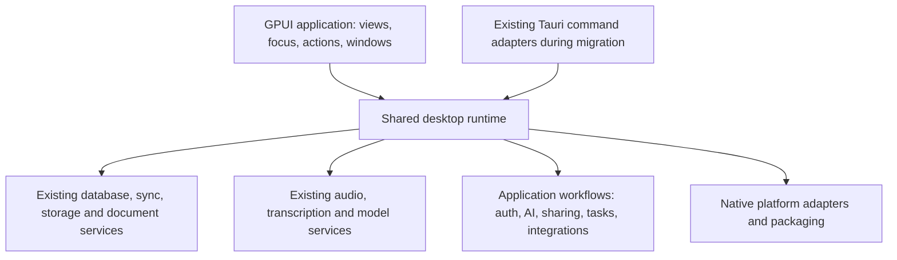

# Desktop GPUI migration plan

Planning date: November 16, 2026 (Asia/Seoul). Status: proposal; implementation and release gates remain open. Parent: [ANLG-320](https://linear.app/fastrepl-inc/issue/ANLG-320).

Build a standalone GPUI desktop application alongside the existing Tauri application. Reuse the Rust domain services, move application behavior out of React and Tauri adapters where necessary, and replace every desktop product surface with native GPUI views. Keep existing documents, libraries, accounts, recordings, settings, and external contracts compatible. Retain the current application until the replacement passes qualification and a stable rollback window.

The recommended first investment is a two-week reconciliation and feasibility tranche. Establish what existing native work can be reused, prove the hardest editor and accessibility interactions, and measure the current application before committing the full team to the port. For three full-time engineers, use **30–45 calendar weeks to full desktop cutover**, plus at least one stable release cycle before retirement, as an initial planning range. Re-estimate after M0–M2. This is an engineering estimate, not a measured forecast or delivery commitment.

## 1. Scope and assumptions

- The final desktop renders all owned product UI in GPUI, including the editor, settings, onboarding, note windows, composer, floating recording controls, captions, and dictation overlays. Ordinary OS dialogs remain native platform integrations.
- No Tauri/Wry/WebView frontend, React renderer, or app-owned TypeScript frontend bundle is required by the final desktop process or installer. External-browser authentication and checkout remain valid workflows.
- Application orchestration currently implemented in TypeScript must move to Rust where the desktop still needs it. This includes background work mounted by React providers, AI SDK flows, persistence and synchronization effects, and task scheduling.
- Existing Rust services, native audio/model libraries, Swift/Objective-C system bridges, server APIs, SQLite schema, sync protocols, and TipTap-dialect ProseMirror JSON are retained where they serve their current purpose. Native product views in a bridge also need a GPUI disposition; an OS service bridge does not need a rewrite merely because it is not Rust.
- Web, mobile, watch, and backend product rewrites are outside this plan. Shared packages remain until their other consumers no longer need them. CLI/MCP/API behavior affected by shared extractions stays compatible.
- Full current desktop feature parity is the default. Any removal needs a specific product decision; inaccessible, disabled, or placeholder controls do not count as migrated features.
- Initial pilot sequencing assumes macOS first. macOS, Windows, and Linux feasibility/build work starts immediately, and full migration is complete only when all shipping targets qualify. This sequencing is a proposal, not a newly accepted change to ANLG-320's cross-platform outcome.
- Staffing assumption: three full-time engineers, approximately half-time QA, and regular design/release support. Named owners and actual capacity are still unassigned.

## 2. Starting point and evidence

This is a continuation of existing work, not a greenfield framework choice. Preserve the milestone IDs M0–M12, work packages W01–W18, and gates G1–G8 from the [existing execution plan](https://linear.app/fastrepl-inc/document/rustgpui-desktop-migration-execution-plan-4ea01a15ee73). Use its [command and surface inventory](https://linear.app/fastrepl-inc/document/rustgpui-migration-command-and-surface-inventory-de15933fe8b2) as the seed for a refreshed implementation ledger. This document is a concise repository planning baseline, not a replacement for the detailed implementation evidence in Linear.

Verified during this planning pass:

- This checkout contains `apps/desktop`, but no `apps/desktop-gpui` or `crates/desktop-runtime`. It is a shared GitButler workspace with unrelated work; no native candidate was applied or modified.
- [PR #7356](https://github.com/fastrepl/anarlog/pull/7356) and [PR #7720](https://github.com/fastrepl/anarlog/pull/7720) are closed, unmerged drafts. Their published heads are respectively `3632bf4b293478d5efe757a85badf284748a7baf` and `2fc8da45378061a1412560756539408115446693`. Neither is evidence of a shipped migration.
- The Linear execution plan, updated November 15, describes a newer local candidate and extensive checkpoints. That candidate's source and ledger were not available in this checkout and were not verified here. Recover its latest owning checkout/export before deciding to reuse or replace any implementation. Do not restore the September PR wholesale over newer work.
- The current desktop has 1,357 TypeScript/TSX files and approximately 292,351 lines under `apps/desktop/src`, including tests but excluding generated files and locale catalogs. The editor adds 93 source/test files and 16,643 lines. These counts describe inventory size, not porting effort or production-only code.
- React currently hosts application services: attachment transfers, shared-note publication/cache, capture recovery, scheduled recording, dictation, tool registration, and enhancement startup. Replacing JSX alone would lose those behaviors. See [main lifecycle](../../apps/desktop/src/main/lifecycle.tsx).
- Tauri owns startup, process/channel locks, Tokio setup, DB opening, plugin initialization, and coordinated shutdown. See [desktop host](../../apps/desktop/src-tauri/src/lib.rs).
- The editor has a structured document schema with tables, tasks, images, attachments, app links, mentions, session references, clips, and inline marks. `crates/tiptap` supplies conversion/validation; it is not an editing engine. See [schema](../../packages/editor/src/note/schema.ts) and [Rust TipTap entry point](../../crates/tiptap/src/lib.rs).

The earlier inventory counted 437 statically registered commands, with external plugins and core APIs tracked separately. Treat that as a November 13 historical count. Reconcile registrations, generated commands, capabilities, dynamic callers, feature flags, and mounted behavior against the selected implementation base before relying on it.

### Framework findings that change the plan

Upstream GPUI is still pre-1.0 and documents breaking changes. Its current source separates platform hosting through `gpui_platform` and describes macOS, Windows, and Linux backends. Pin a tested source revision and compatible toolchain; do not use a floating dependency. [GPUI README](https://github.com/zed-industries/zed/blob/main/crates/gpui/README.md)

Current upstream source includes AccessKit integration and APIs for semantic nodes, actions, and custom text children. The prior candidate's GPUI 0.2.2 accessibility limitations must therefore be checked against its exact pin and a current upstream candidate. A crate version string alone does not establish equivalent source. Integration is not proof that Anarlog's editor works with screen readers. [GPUI accessibility source](https://github.com/zed-industries/zed/blob/main/crates/gpui/src/_accessibility.rs)

Longbridge's former `gpui-component` repository now redirects to GPUI Kit. Evaluate its existing inputs, lists, menus, themes, and accessibility behavior before building equivalents. Adopt only the pieces that pass our interaction tests; its Markdown/HTML rendering does not establish ProseMirror editing compatibility. Avoid its optional JavaScript shell unless an existing product capability specifically requires it. [GPUI Kit](https://github.com/longbridge/gpui-kit)

GPUI declares Apache-2.0; Zed's editor crate declares GPL-3.0-or-later. Reusing the framework does not imply that copying the editor has the same license boundary. Inspect the exact dependencies before reuse and preserve the repository's community/enterprise boundary. [GPUI manifest](https://github.com/zed-industries/zed/blob/main/crates/gpui/Cargo.toml), [editor manifest](https://github.com/zed-industries/zed/blob/main/crates/editor/Cargo.toml)

## 3. Target architecture

Start with two new or recovered ownership boundaries, rather than a crate per screen:

| Location                               | Owns                                                                                                           | Must not own                                       |
| -------------------------------------- | -------------------------------------------------------------------------------------------------------------- | -------------------------------------------------- |
| `apps/desktop-gpui`                    | GPUI entry point, views, navigation, focus, theme, assets, window composition, UI adapters                     | Independent copies of database/sync business rules |
| `crates/desktop-runtime`               | Application lifecycle, typed application actions, service coordination, background jobs, shutdown              | GPUI entities, Tauri handles, rendering            |
| Existing `crates/*`                    | Database/migrations, reactive queries, storage, audio, transcription, models, agent access, updater algorithms | UI-specific policy added merely to simplify a port |
| Existing `plugins/*` during transition | Thin Tauri adapters to extracted services                                                                      | A second implementation of newly extracted logic   |
| Native platform modules                | OS windows, permissions, credentials, dialogs, tray, shortcuts, packaging hooks                                | Product workflow duplication across platforms      |

Reuse candidate boundaries if they are sound. Extract another crate only when there is an actual shared consumer, dependency boundary, or independent ownership need. A small internal module is sufficient for most screens.

Resolve the native dependency graph at M2. Preserve separate Cargo workspaces/lockfiles if the recovered candidate requires incompatible GPUI/platform dependencies. Consolidate only after a compatibility build; do not downgrade or destabilize the shipping workspace to satisfy the preview.

### State, async work, and persistence

- Use GPUI entities for view state, focus, selection, open panels, and rendering notifications. Keep durable state in the existing database/services. Prefer local state over a replacement global store.
- Run I/O and long work on the existing Tokio/service runtime. GPUI owns the platform UI thread. Avoid nested runtimes and blocking DB/network/model work during rendering.
- Expose typed service methods and domain events. Keep the API narrow; do not rebuild the Tauri string-command bus inside GPUI or introduce a network process merely to avoid extraction.
- Give each background service one application-level owner. Opening a second window must not create another recorder, sync loop, scheduler, or attachment uploader.
- Scope requests and responses to account/library/session identity and operation generation. Drop stale completions after switching accounts or closing views. Recheck authorization and expected revision in the write transaction, not only when work starts.
- Coalesce replaceable UI signals such as amplitude, playback position, or transcript partials. Preserve final transcript events and durable mutations in ordered, bounded paths. UI backpressure must never block real-time audio callbacks.
- Reuse `db-core`, `db-app`, `db-migrate`, and `db-reactive` ownership. Replace React/TanStack adapters with native subscriptions; use existing write and invalidation paths rather than untracked direct SQL mutations.
- Centralize graceful shutdown: stop admitting work, resolve composition/drafts, finalize or journal capture, drain required writes, cancel/join remaining jobs, then close the database. A window close is not automatically application shutdown.

### Transition strategy

Keep two separately launchable applications sharing domain code. Preview starts on isolated fixtures/profiles. Later, the applications may adopt the same supported profile sequentially under exclusive ownership. Never run two writers against a user's library as a parity experiment.

Prefer whole workflow slices: load a session, edit it, save it, restart, and verify it in the existing app. Avoid a permanent mixed React/GPUI window or an embedded ProseMirror WebView. Those would leave the hardest migration unfinished and introduce extra event-loop/focus ownership.

## 4. Complete work breakdown

Every row needs an accountable person, a current source reference, a destination, dependencies, and behavior/persistence/platform evidence in the implementation ledger. Status values are `unassessed`, `candidate`, `partial`, `verified`, or `approved removal`. Verification always names a build, fixture, and platform. Existing code or a passing isolated unit test is not general parity.

| ID  | Surface and source                                           | Deliverable and acceptance                                                                                                                                                                                         |
| --- | ------------------------------------------------------------ | ------------------------------------------------------------------------------------------------------------------------------------------------------------------------------------------------------------------ |
| W01 | Startup, routes, onboarding, lock/readiness gates            | Fresh/upgrade/slow/failed startup; one welcome note; persisted completion; deep links arriving before readiness; correct close/hide/quit and recovery.                                                             |
| W02 | `packages/ui`, styles, i18n, common controls                 | Design tokens, fonts, icons, focus, menus, forms, dialogs, virtual lists, notifications; accessible semantics; localization/plurals/RTL; zoom, contrast, reduced motion. No need to duplicate unused web controls. |
| W03 | Sidebar, tabs, folders, search, navigation                   | Current sort/filter/tie-break rules; create/move/delete/undo; bulk selection; tabs/history/pins; locked/shared states; large-corpus behavior with bounded loading.                                                 |
| W04 | `packages/editor`, editor bridge, note/summary UI            | Native rich editor preserving ProseMirror JSON, IDs, unknown content, metadata, clipboard, IME, selection, undo, tables/tasks/attachments, autosave and conflict recovery. Detailed contract below.                |
| W05 | Sessions, participants, contacts, templates, automations     | Canonical session/note identities; CRUD/merge; template selection/import/share; automation triggers and schedules; durable retry/cancel and duplicate prevention.                                                  |
| W06 | `stt`, audio player, transcription/audio services            | Capture start/stop/finalize; device priority/hotplug; partial/final words and speakers; correction, waveform/seek/speed; retention; sleep/crash and interrupted import recovery.                                   |
| W07 | Dictation, composer, floating bar, captions, instructions    | Separate native windows; correct focus and position; global press/release/cancel behavior; intended target capture and safe insertion; mutual exclusion with meeting capture; retained text when insertion fails.  |
| W08 | AI, chat, edit requests, tasks, scheduler/tools              | Persistent conversations; streaming/reasoning; context and attachments; summaries/titles; diff review and approvals; retry/cancel; provider and entitlement parity. Move required AI SDK orchestration to Rust.    |
| W09 | Authentication, credentials, app lock                        | Browser/PKCE callback handling; refresh races, offline/expiry/revocation; sign-out and account switch cancellation; keychain repair; OS/biometric lock; correct credential namespaces.                             |
| W10 | Database, sync, E2EE, library ownership                      | Existing-profile adoption and rollback; same schema and active transport; identity binding and device enrollment; local/remote conflicts and tombstones; bounded catch-up and recovery-key behavior.               |
| W11 | Attachments, resource/session sharing, shared notes          | Resumable transfer, hashes, cancellation, retry/eviction; shared previews and auth transitions; folder-default access; revoke/delete guards; no cross-account cache or result leakage.                             |
| W12 | Settings, billing, team, insights, referrals, CRM            | Every reachable screen and actual side effect; typed values/defaults; local/synced/managed precedence; free/trial/paid/expired states; checkout, invitations, roles and policy.                                    |
| W13 | Calendar, imports/exports, external tasks, capture ingestion | Provider and local calendar flows; recurrence/timezones/DST; auto-start/join; idempotent imports preserving IDs; all supported export formats; reminders/Linear/GitHub and enterprise client integration.          |
| W14 | Local STT/LLM, provider/model configuration                  | Model registry/download/verify/cancel/delete/custom paths; engine start/stop/crash; memory/disk limits; provider credentials, endpoint options, language and platform restrictions.                                |
| W15 | Windows, tray, shortcuts, permissions, observability         | Single-instance forwarding; menus/title bars; saved frames/DPI/monitors; notifications/actions/DND; Dock/autostart; dialogs/open/reveal; capture permissions; consent-aware telemetry/crash logs and redaction.    |
| W16 | CLI, local API/MCP, hooks, agent, relay, developer controls  | Embedded CLI install/repair/version; agent skills; authenticated local servers; limits and lifecycle; opt-in backfill; existing tool/event contracts; explicit disposition of scripting/relay capabilities.        |
| W17 | Build, packaging, updates, release channels                  | Signed installers and sidecars/resources; compatibility with current feed/signatures; resumable verified downloads; safe install/relaunch; upgrades, failure recovery, uninstall and rollback.                     |
| W18 | Performance, qualification, support, retirement              | Reproducible benchmarks and soak; diagnostic/support paths; staged cutover; rollback window; dependency/consumer audit and removal of desktop-exclusive legacy code.                                               |

Current settings scope includes account, billing, referrals, insights/stats, app, meetings, appearance, notifications, sync, team, imports, CRM, permissions, privacy, developers, dictionary, dictation, transcription, intelligence, and todo. A field is complete only when its service effect succeeds, failure is visible, and restart behavior matches.

Inventory all mounted tabs, route windows, dynamically registered tools, background lifecycles, application/plugin commands, third-party Tauri APIs, settings keys, build assets, and feature/platform flags. Trace dormant route variants before deciding they are shipping features. Use a generator/lint check for inventory drift and dependency rules; do not add tests that merely mirror file layout or enum lists.

## 5. Editor: the critical path

The editor is its own workstream. GPUI provides rendering/input foundations; a code editor or Markdown renderer is not a substitute for Anarlog's structured document behavior.

1. **Recover and qualify the existing native editor.** Compare its document/transaction model and fixtures with the current schema. Keep correct implementations; discard assumptions based on older source. Evaluate an upstream-supported input component for ordinary text fields separately.
2. **Keep a lossless document model.** Retain node names, nesting, attributes, marks, stable identities, and opaque unknown fields. Preserve unsupported nodes as opaque content with an explicit editing boundary. Opening/closing an unchanged document must not write or normalize it. Do not convert documents through Markdown as the storage path.
3. **Implement editing transactions.** Selection mapping, insert/delete/replace, marks, split/join blocks, list indentation, table operations, undo grouping, redo, and external-update handling must be explicit and independently testable. JSON storage compatibility does not imply ProseMirror transaction compatibility.
4. **Connect layout and native input.** Text shaping, wrapped lines, hit testing, caret/selection geometry, scrolling, drag selection, block widgets, and accessibility text ranges must share a consistent position model. Define byte/UTF-16/grapheme conversions and composition ranges; do not equate Rust byte offsets with browser document offsets.
5. **Finish app-specific behavior.** Slash commands, mentions, session/app links, clips, tasks and task identity, comment anchors, AI highlighting, search/hashtags, toolbar, images and attachments, link boundaries, clipboard and file drops, spellcheck, and export fidelity.
6. **Make saves safe.** Preserve canonical note and summary identity/metadata. Reject stale writes with a user-recoverable conflict path. Coordinate multiple windows and remote changes; undo must not erase another writer's changes. Journal recoverable drafts with a measured loss bound and flush at supported shutdown boundaries.

Schema coverage includes doc/text, paragraphs, headings 1–6, blockquote, codeBlock, horizontalRule, hardBreak, bullet/ordered lists, listItem, table/row/cell/header including spans/widths, taskList/taskItem, image, fileAttachment, appLink, `mention-@`, session, and clip. Marks include bold, italic, underline, strike, code, link, and highlight. Cover metadata/plugins as well as schema names.

Editor exit evidence:

- Golden documents generated by the current shipping editor survive Tauri → GPUI → Tauri, including no-op and edit round trips. Declare any permissible normalization narrowly.
- Korean, Japanese, and Chinese composition commit/cancel; emoji, combining characters, RTL/mixed direction; selection across lists/tables/inline widgets; undo after paste and composition; blur/quit during composition.
- Plain text, HTML, images, and files copied/pasted/dropped from real applications. Preserve links, attachment references, and task/comment identity; unsupported content fails without silently deleting it.
- Screen readers can navigate, select, edit, and announce meaningful changes. Virtualization does not make content unreachable or break selection.
- Long notes/transcripts remain responsive while autosaving and receiving remote updates. Disk-full, permission failure, forced process exit, and stale-revision cases preserve recoverable content.

Do not enable broad writable-profile adoption while the lossless model and stale-write behavior are incomplete.

## 6. Data, identity, and rollback

Renderer migration must not become a storage migration. Share the current owning crates and active sync transport. The separate SQLite Cloud/provider work in this repository is a moving dependency: rebase and test against its accepted runtime rather than transplanting the older GPUI candidate's transport or replica handling.

Preserve sessions, primary note identity, summary identities, ownership/workspace fields, deletion markers, transcript timing/speakers, attachment references/hashes, chat/task records, settings, and pending recovery state. Retain append-only migrations and desktop/mobile parity. Any unavoidable new persistent field needs its own additive compatibility review; no breaking schema is required by the UI port itself.

Profile adoption sequence:

1. Resolve current channel/bundle identity, custom DB and vault paths, settings, credentials, model directories, and legacy pointers using the shipping code. Do not assume they all live under the database directory.
2. Prove profile quiescence across both shells and stable/nightly channels. Existing startup code distinguishes launch locks from lifetime channel ownership. Establish a cooperative maintenance lock only with supported-host participation; account for older hosts that do not honor it.
3. Preflight schema compatibility, space, integrity, recovery markers, and path/ownership constraints. Handle SQLite WAL in a consistent snapshot; do not copy an active DB file alone or blindly follow symlinks.
4. Create and verify a recoverable backup/clone. Keep the original usable if preflight or adoption fails. Initially open only isolated copies; a preview marker is not permission to bypass incompatibility checks.
5. Adopt secure-store records without exporting secrets. Qualify account/library binding, keychain access groups, credential repair, token refresh, E2EE keys, and settings precedence. Imported WebView localStorage values need an explicit extraction/compatibility path, not an assumption that GPUI can read browser state.
6. Exercise GPUI writes, then reopen with the supported Tauri rollback release. Compare logical records, IDs, metadata, audio/attachment hashes, sync state, and pending operations, not only SQLite integrity.
7. Switch the installed shell/profile pointer only after the rehearsal passes. Maintain one writer and a durable, recoverable switch operation through crashes and interrupted updates.

Rollback normally means using the previous compatible binary on the current compatible data. Restoring an old database snapshot can discard valid later edits and is a separate recovery operation. Document the distinction and test both paths where supported.

## 7. Milestones and sequencing

| Milestone                            | Depends on                      | Concrete exit                                                                                                                                                                     | Accountable role          |
| ------------------------------------ | ------------------------------- | --------------------------------------------------------------------------------------------------------------------------------------------------------------------------------- | ------------------------- |
| M0: Reconcile inventory and baseline | Plan                            | Latest native candidate located and pinned; current-source inventory/delta; owners; reproducible fixtures; measured Tauri baseline and frozen performance protocol.               | Migration lead + QA       |
| M1: Shared runtime                   | M0                              | Tauri and native adapters use the same extracted service contracts; explicit task/cancellation/shutdown ownership; representative contract/recovery tests pass.                   | Runtime engineer          |
| M2: GPUI feasibility and foundations | M0, coordinated with M1         | Pinned dependency decision; all OS families build; accessible text/input/button/dialog/list spike; hardest IME/editor operation works; theme/i18n and iteration loop established. | UI/platform engineer      |
| M3: Profile adoption and rollback    | M1                              | Old/new/old tests on ordinary/legacy/large profiles; keys/paths/replicas preserved; interrupted preflight/adoption leaves original usable.                                        | Runtime engineer          |
| M4: Library and editor               | M1, M2; M3 before real profiles | W03–W05 and editor attachments: complete create/edit/save/reopen workflow, all document interactions, large-library behavior.                                                     | Editor engineer           |
| M5: Recording and dictation          | M1, M2; M4 integration          | W06–W07; deterministic capture/recovery plus real devices; floating/caption/composer behavior and safe dictation insertion.                                                       | Runtime/platform engineer |
| M6: Identity, cloud, sharing         | M1–M3                           | W09–W12 identity/sync/team/sharing cases; two-client sync/E2EE/transfer checks; sign-out/account-switch isolation.                                                                | Runtime engineer          |
| M7: Remaining product workflows      | M1, M2; M4–M6 as applicable     | W08, W12–W14, W16 complete: AI/chat/tasks, settings effects, integrations, models, CLI/MCP and developer features.                                                                | Product/UI engineer       |
| M8: Native distribution              | M2 and M1 lifecycle             | Signed native previews; every package/resource/update path qualified; no accidental dependency on the frontend source tree.                                                       | Platform/release owner    |
| M9: Full qualification               | M3–M8                           | G1–G7 evidence complete for target cohort/platforms; independent data/release review; all-platform matrix required for full migration completion.                                 | QA + migration lead       |
| M10: Opt-in release preview          | M9 for the selected platform    | Explicit opt-in, real-profile adoption, support diagnostics, upgrade/rollback rehearsal, monitored task success. Isolated internal previews may exist earlier.                    | Release owner             |
| M11: Default cutover                 | M10 and gates for target cohort | Controlled rollout, stable telemetry, current-data rollback available. Expand to every shipping target before calling migration complete.                                         | Release owner             |
| M12: Retire legacy desktop           | M11 + stable release cycle      | G8; remove only desktop-exclusive Tauri/React code and resources; fresh install/upgrade and other products remain healthy.                                                        | Migration/release lead    |

The critical path is M0 → M1/M2 → M3/M4 → M5–M8 integration → M9 → M10/M11 → M12. Start packaging prototypes and Windows/Linux feasibility during M2, not after finishing macOS screens. Each port lands as a reviewable workflow slice with its behavior tests and inventory evidence.

### First two weeks

| Time      | Work                                                                                                                                 | Reviewable result                                                                    |
| --------- | ------------------------------------------------------------------------------------------------------------------------------------ | ------------------------------------------------------------------------------------ |
| Days 1–3  | Recover newest candidate and ledger; compare to current main; enumerate mounted surfaces/services and obsolete assumptions.          | Pinned baseline and reuse/gap list; no wholesale history import.                     |
| Days 2–5  | Capture release baselines with fixed fixtures; isolate UI versus DB/sync/audio costs.                                                | Raw benchmark artifacts and initial budgets; no performance claims from screenshots. |
| Days 3–8  | Qualify existing versus current upstream GPUI; prototype IME, rich-text selection, screen-reader text and a modal on each OS family. | Dependency decision and explicit blockers; tested native input path.                 |
| Days 5–10 | Extract one small runtime contract; wire native session loading and save on an isolated profile; run old/new/old.                    | One actual vertical slice and a revised schedule based on observed gaps.             |

This tranche is not a requirement to complete the entire runtime or editor in two weeks. If an early gate fails, record the precise blocker, recovery options, and revised cost before expanding the port.

### Staffing and estimate

- Engineer A owns native foundations, workspace/product views, and platform integration.
- Engineer B owns the editor, document semantics, input/accessibility, and persistence integration.
- Engineer C owns shared runtime, capture, identity/sync, and release integration.
- QA owns fixtures, manual critical journeys, device/platform coverage, and release evidence; design reviews fidelity and interaction behavior throughout.

Initial effort budget: roughly 80–120 engineer-weeks across reconciliation/foundation (12–18), editor/workspace (18–28), runtime/data/auth (16–24), capture/AI/product integrations (20–30), and release/qualification (14–20). These are overlapping streams, not sequential phase durations. Capacity contention and integration put three-engineer delivery at roughly 30–45 calendar weeks. Existing verified code may reduce that; unavailable candidate source, a major editor gap, or a maintained platform fork may increase it.

Aim for an internal end-to-end alpha in roughly 10–16 weeks, subject to the initial gates. Alpha is not feature parity or readiness for user-profile adoption. Reforecast at M2 and after the complete feature inventory has owners. Do not infer speed from lines of generated Rust or past test counts.

## 8. Validation and measurable acceptance

| Gate                      | Must be demonstrated                                                                                                                                                                              |
| ------------------------- | ------------------------------------------------------------------------------------------------------------------------------------------------------------------------------------------------- |
| G1: Coverage              | Every reachable workflow, command, lifecycle, setting, window, capability, sidecar, and resource has verified replacement evidence or a specific approved removal.                                |
| G2: Data                  | Old/new/old compatibility; stable identities and unknown-content preservation; safe failed saves, concurrent updates, adoption and recovery; no unresolved data-loss or account-isolation defect. |
| G3: Interaction           | Keyboard completion, correct focus, VoiceOver/NVDA or Narrator/Orca, editable text ranges, IME/CJK, clipboard/drop, spellcheck, DPI/zoom/RTL and reduced motion.                                  |
| G4: Product/services      | Offline/signed-out/free/trial/paid/expired/managed cases; providers/local engines; retry/cancel/rate limits; real side effects and errors; all critical journeys finish.                          |
| G5: Platform/distribution | Current OS/architecture/package coverage, minimum OS/system libraries, permissions, credentials, single instance, windows, tray, signing and installation.                                        |
| G6: Performance/stability | Equivalent workloads/features in release builds meet frozen resource/latency budgets and show bounded long-run behavior.                                                                          |
| G7: Release/rollback      | Signed immutable candidate and update provenance; safe install/relaunch; interrupted-update recovery; successful Tauri → GPUI → Tauri; rollout stop procedure.                                    |
| G8: Retirement            | Prior gates and rollback window complete; no remaining consumers of removed code; no desktop WebView runtime/bundle; unrelated products and release paths pass.                                   |

### Automated and manual coverage

Use the repository testing skill: cover observable contracts, data integrity, authorization, lifecycle races, and recovery. Keep existing effective tests and add one focused regression case per discovered bug. Do not test CSS equivalents, private state, mock call counts, or file organization.

Test layers:

1. Shared domain tests and adapter contract tests for values, errors, ordering, and cancellation.
2. Editor fixture/differential tests, transaction invariants, and bounded property tests for valid edits and serialization.
3. Native integration tests with temporary DB/vault, mock audio/providers, and GPUI input/focus test support.
4. Real OS checks for IME, accessibility, clipboard, drag/drop, GPU/window behavior, permissions, devices, global shortcuts, keyrings, and installers.
5. Signed release-package upgrade/rollback and crash/recovery drills against isolated profiles and service accounts.

Critical journeys: install/onboard; create/edit/reopen/recover; search/folder/bulk-delete/undo; record → transcript → summary; dictation into another app; configure model/provider; sync two clients; share/revoke/download; calendar/scheduled capture; import/export/relocate; chat/tool approval/tasks; lock/sign-out/account switch; multi-window/tray/deep link; update and rollback. Exercise failure/interruption variants as well as successful flows.

Preserve current desktop targets: macOS arm64 and x86_64, Windows x86_64 MSVC, Linux x86_64 and aarch64. Check macOS direct-distribution and App Store restrictions separately. Test Linux X11 and Wayland independently, including actual desktop portal behavior; a software-rendered VM or fake portal is not physical hardware qualification. Freeze the supported OS/library minima from the current release configuration at M0.

Extend CI with required native checks for the new app and changed shared crates. Use locked Cargo check/test/Clippy, Rust format, relevant generated outputs, license boundaries and dependency checks. Keep current desktop/mobile/web/CLI/API consumers covered when shared crates change. The existing desktop native jobs are scheduled/dispatched; aggregate PR green alone does not qualify a candidate. Signed release evidence must name each required job and exact SHA.

### Performance protocol

Benchmark equivalent optimized builds on named hardware, same fixtures, OS, display/refresh, power mode, settings, and sync state. One warm-up plus at least five measured runs; collect enough event samples for meaningful p95 latency. Retain raw measurements, variance, build SHA, fixture version, tools, and process attribution. Include all app-owned helpers; distinguish physical/private memory from summed RSS and record missing GPU attribution.

Scenarios: cold-process launch, ten-minute idle with sync off and caught up, large library/search, long editor/undo/autosave, live transcript, waveform/playback, fixed sync catch-up, and a 60-minute capture/editor/sync soak. Separate deterministic mock runs from real-device capture validation.

Preserve ANLG-320's provisional targets until baseline variance permits an explicit decision:

- At least 30% lower median whole-app CPU in live transcript, large editor, and playback; at least 30% lower physical/private memory for idle and large sessions.
- Input-to-paint p95 and jank no worse than 5%; launch and sync/import/export throughput no worse than 5% without an accepted tradeoff.
- No unbounded memory, queue, task, or GPU-resource growth after warm-up. Fix a byte budget and tolerated soak growth at M0 rather than calling every increase acceptable.
- Recording and persistence correctness are absolute gates, not percentage-regression allowances.

If renderer-bound gains are under 15%, or shared DB/sync/audio work dominates, reassess the expected benefit and optimization priorities. That finding does not silently cancel the requested migration or waive correctness gates. A thinner feature set is not a fair performance comparison.

## 9. Packaging, rollout, and retirement

Start an independently installable preview with its own identity and isolated profile. This avoids accidental production-profile access but does not prove production Keychain/TCC/update identity compatibility. Rehearse the final identity transition explicitly.

Native packaging must retain icons, entitlements, usage descriptions, protocol/file associations, fonts/locales, model engines, audio/speech frameworks, native shared libraries, embedded CLI/skills, license notices, and crash symbols. Move resource ownership out of the legacy frontend tree before deleting it. Replace WebView-dependent PDF/export or asset paths with qualified native equivalents where currently reachable.

Reuse updater-core where suitable, while replacing the Tauri host. Preserve signature and architecture/channel checks, resumable downloads, recording/write deferral, installation repair, and relaunch semantics. The final Windows installer must not install WebView2 merely because an old template still does. Qualify macOS notarization/Gatekeeper and App Store lanes, Windows signing/NSIS, Linux AppImage/deb and downstream package channels according to current distribution.

Suggested rollout after qualification: internal users → explicit opt-in cohort → 5% → 25% → 100% of eligible users on the selected platform. Treat percentages as a release proposal; use minimum completed journeys and a dwell period at each stage so a small cohort cannot advance on empty telemetry. Freeze those counts/time windows at M9. An offline local-first app also needs a documented manual installer/rollback path.

Stop expansion immediately for confirmed data loss, unsafe cross-account access, capture loss, unrecoverable launch/update failure, or a blocked critical accessibility journey. Pause on agreed crash/task-success/performance regressions and investigate against the same build and cohort. On rollback, stop admission/capture safely, flush recoverable state, release profile ownership, and launch the compatible prior release; do not reset the DB automatically.

Keep the Tauri rollback release installable and compatible for at least one full stable release cycle after GPUI becomes default on the relevant platforms. Delay retirement if rollback or incident recovery still depends on it.

Retirement checklist:

- All W01–W18 entries and G1–G7 have current evidence for supported targets.
- Remove desktop React/Tauri runtime, thin adapters no longer used, frontend bundles, build resources, generators, and CI lanes only after a consumer audit.
- Keep shared UI/editor/data packages needed by web/mobile and preserve independent CLI/MCP/API contracts.
- Inspect the dependency graph, packaged files, and running process tree. The native desktop must start and complete local workflows offline on a fresh supported machine without a hidden WebView.
- Update contributor/dev commands, release tooling, support diagnostics, documentation, screenshots, and troubleshooting instructions.
- Run final fresh-install, upgrade, current-data rollback, and unaffected-product checks; close G8 and ANLG-320 only when the actual outcome is achieved.

## 10. Decisions, risks, and next action

| Decision/risk                                   | Recommended default                                                                                                                                        | Resolution point                                   |
| ----------------------------------------------- | ---------------------------------------------------------------------------------------------------------------------------------------------------------- | -------------------------------------------------- |
| Newer native candidate is outside this checkout | Recover its exact source/ledger and reuse verified pieces; never reset another owner's work.                                                               | M0, before implementation estimates are committed. |
| Older GPUI pin versus upstream/Kit              | Prefer the smallest supported dependency set that passes input/accessibility/platform tests; pin it and assign upgrade ownership.                          | M2.                                                |
| Rich editor effort                              | Preserve existing JSON and build/qualify the native transaction model; no Markdown conversion or permanent WebView fallback.                               | Early M2 spike; full M4 gate.                      |
| Platform fork                                   | Prefer upstream fixes; any necessary fork has a minimal patch list, owner, upstream path and maintenance budget.                                           | M2 before scaling UI work.                         |
| Ongoing sync/storage changes                    | Integrate the current owning runtime; independently test recovered native assumptions.                                                                     | M1/M3 and each baseline refresh.                   |
| Runtime dependencies on Tauri or TS             | Extract only required product behavior into existing services/runtime; use compiler/dependency checks to prevent new coupling.                             | Each workflow slice.                               |
| Feature growth during migration                 | Maintain a delta ledger; every desktop feature change identifies both-shell impact and its owner. Keep monthly integration checkpoints.                    | From M0 until retirement.                          |
| Scripting/plugins                               | Preserve reachable user capabilities with an explicit host/security contract; frontend removal does not authorize deleting them or rewriting the monorepo. | W16 before G4/G8.                                  |
| Hardware, providers, signing and readers        | Reserve real test machines/devices/accounts and release capacity early; missing evidence remains an open gate.                                             | M0 resource allocation.                            |
| Estimates and pilot sequence                    | Three engineers; macOS pilot first, all current targets in final scope; reforecast from measured reuse and blockers.                                       | M2 review.                                         |

The next implementation checkpoint is M0 plus the smallest M2 proof: recover the newest native candidate, refresh its coverage against current main, and demonstrate a lossless editable note with IME and screen-reader access on an isolated profile. In parallel at the team level, establish the Tauri benchmark and native platform builds. Do not begin by recreating every screen or deleting the current desktop.

Planning validation: this document is based on source inspection, current Linear records, GitHub PR state, and upstream documentation. It does not claim a GPUI build, live product parity, performance measurement, signed distribution, or a completed release gate. No implementation, external plan update, push, or PR is part of this planning checkpoint.
