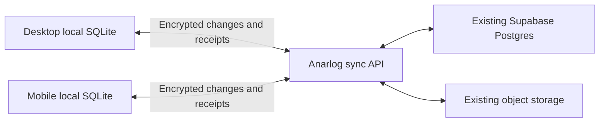

# SQLite Cloud to Supabase migration runbook

## Status and use

- **Revision:** 2, November 15, 2026, Asia/Seoul.
- **Status:** Execution started November 15 at John's direction. The server work is merged and deployed: `anarlog-sync` and `anarlog-core` serve `main` at `c0491acae3` in `enabled` mode since November 15 16:23 and 16:31 UTC, which changes nothing users see. Supabase point-in-time recovery is on. Desktop 1.4.35, the minimum build for draining, was published November 15 at 20:38 UTC. No account's transport has changed. P0 and P1 are closed except for the items named in the ledger; P2 has several unqualified items. On November 16 John amended Gate P2's restore requirement (section 9).
- **Owner:** John Jeong. The engineer executing the migration maintains this file.
- **Tracking:** [ANLG-554](https://linear.app/fastrepl-inc/issue/ANLG-554/retire-sqlite-cloud-using-supabase-encrypted-replica-sync).
- **Canonical plan:** This file. Update it in place as decisions or evidence change; do not create competing plans in subsequent chats.
- **Current authorization:** On November 15 John directed the work to continue until the migration is complete. Later that day (about 15:05 UTC) he decided four points: bundle sqlite-sync 1.2.2 rather than ask SQLite Cloud for written confirmation; accept the recoverability reading in section 2, so the data gate is archive-and-record rather than zero unresolved records; keep the `accepted_replica` gate, with the next stable desktop release as the minimum build; and go ahead now with the `enabled`-mode deploy of sync and core, point-in-time recovery, the restore drill, and the verification accounts. On November 16 he amended Gate P2: it requires point-in-time recovery and the restore order in section 9 instead of loss-free recovery, with the client recovery path scheduled separately as ANLG-555. Each remaining gate still needs its evidence before the step it guards, and irreversible steps (provider resource deletion, cancellation) are taken only after their gate is recorded as passed.

Before continuing in another session, read this file, the execution ledger, the linked issues, and the current component instructions. Confirm the actual checkout, deployed versions, and environment. A checked box requires evidence tied to a version, environment, and time. Code existence, merged PRs, and earlier observations do not establish current production readiness.

Reviewing this plan settles the approach and defaults below. Production measurements and provider capabilities remain explicit preflight gates; do not invent their results to declare the plan executable.

## 1. Outcome and boundaries

Move Anarlog's hosted synchronization to its existing encrypted replica API backed by Supabase Postgres. Keep local SQLite, durable offline writes, E2EE keys, and the existing accepted-state/conflict protocol. Retire Anarlog's SQLite Cloud hosting dependency and verify that the CloudSync Enterprise charge ends.

Local reading, editing, and recording must continue through rollout and a temporary sync outage. Cross-device sync continuity is a qualification target, not a consequence of local-first storage. Unsupported old clients may need an update before cloud sync resumes; their local data must remain recoverable.

Included: personal/shared workspaces, enrollment and recovery, sharing/web editing/live collaboration, attachment references, deletion and revocation, deployment checks, operational costs, and provider retirement. Inventory CLI, local/hosted MCP, and other native consumers for shared-runtime impact.

Excluded from this migration: a new sync vendor, plaintext cloud storage of private notes, changed document conflict policy, a new collaboration engine, another database host/region, relocating existing object storage, and Char's separately billed resources. Keep the current Supabase project initially. A capacity blocker stops rollout rather than silently creating a second project.

Retain the local CloudSync extension for the first migration. Existing SQLite triggers and schema initialization can require it even with replica networking. Removing it is a separate local-schema migration, with old-database upgrade and downgrade tests. Verify that retaining the local extension is compatible with the subscription/license exit before scheduling cancellation. The vendored 1.2.0 release was not clearly compatible; [#8196](https://github.com/fastrepl/anarlog/pull/8196) (`90f350c8a8`) replaces it with 1.2.2 under Apache 2.0, so the minimum client build for draining must include that change.

## 2. Evidence and remaining facts

### Observed baseline

These observations came from the November 14 investigation and November 15 source review. Refresh them before execution.

| Observation                                                                                                            | Meaning and limit                                                                                                                                      |
| ---------------------------------------------------------------------------------------------------------------------- | ------------------------------------------------------------------------------------------------------------------------------------------------------ |
| Receipt: $4,473 for November 14–December 14; $4,300 CloudSync Enterprise, $158 for two Pro projects, $15 extra storage | $4,300/month is the primary gross savings target. The receipt does not establish cancellation terms, renewal notice, or the incremental Supabase bill. |
| Production Supabase project `ijoptyyjrfqwaqhyxkxj`, Anarlog, `us-west-1`                                               | Verified through the existing authenticated CLI. The connector returned no projects; that was not proof that the project was absent.                   |
| 2,707 workspaces with encrypted sync initialized; 1,747 with cloud authority activated                                 | Neither count establishes replica-only transport or complete recoverability.                                                                           |
| About 97.75 GB database size; 87.00 GB encrypted event relation; 6.00 GB receipt relation                              | Physical relation sizes include indexes/TOAST. They are not logical note size or provisioned/billed disk.                                              |
| Estimated 27.6 million event rows and 9.5 million receipt rows                                                         | Catalog estimates, not exact reconciliation counts. Do not run an unbounded production scan to refresh them.                                           |
| 2,788 registered devices, 1,899 seen in the preceding 30 days; no per-account transport overrides                      | Device presence does not identify deployed versions or selected transport.                                                                             |
| A new protocol-2 encrypted event was observed                                                                          | The accepted-state path is active, but not qualified here for a complete provider exit.                                                                |
| Main inspected at `0a97fcd408aa62230484787e462be4b56bd4f1ee`                                                           | The local GitButler workspace also contains unrelated applied branches. Preserve their ownership.                                                      |

The source supports per-account transport selection and replica credentials on desktop; mobile requests replica credentials directly. The default desktop transport in source is still `sqlite_sync`. Canonical configuration inspection returned `e2ee_enforced`; the deployed transport default was not conclusively established.

### Refreshed November 15 (read-only)

| Observation                                                                                                                                                                                                                                             | Meaning and limit                                                                                                                                                                                                               |
| ------------------------------------------------------------------------------------------------------------------------------------------------------------------------------------------------------------------------------------------------------- | ------------------------------------------------------------------------------------------------------------------------------------------------------------------------------------------------------------------------------- |
| `supabase migration list --linked` on `ijoptyyjrfqwaqhyxkxj`: every local migration through `20261021045443` is applied and none is pending                                                                                                              | Hosted schema matches `main`. P1 so far adds no hosted migration.                                                                                                                                                               |
| Last successful `api_cd` runs by service: sync `7a58e6ba9c` (October 28, run 40664354707), core and billing `acdf190bde` (October 25), ai `2afba01e93` from a branch (October 19), gateway `36715ccb21` (October 5). Health reports 0.0.101 and 0.0.100 | Sync and core contain #7997, #8050, and #8061. The gateway image predates #8050/#8061 but forwards sync traffic (next row). Only gateway deploys tag, so no tag names the sync image.                                                 |
| No commit on `main` after `7a58e6ba9c` touches `crates/api-sync`, `crates/api-subscription`, `apps/api`, or `supabase/migrations` (checked at `0a97fcd408`)                                                                                           | Deployed sync code equals `main` for these paths until P1 merges.                                                                                                                                                               |
| Infisical prod `/anarlog/cloudsync`: protocol mode `e2ee_enforced`, token TTL 3600 seconds, desktop transport unset, lifecycle mode unset                                                                                                               | Effective transport default is `sqlite_sync`. The Fly inventory below confirms no app stages a transport or lifecycle setting.                                                                                                    |
| `replica` capability header first shipped in desktop 1.4.24 (#7503); accepted-state outbox and update-required handling in 1.4.29 (#7997); contention fixes in 1.4.30. Latest stable tag is 1.4.34                                                      | Builds 1.4.24 through 1.4.28 advertise `replica` without the outbox or any handling of a fenced workspace. Existing identifiers cannot separate them from later builds, so capability negotiation was extended (section 4).     |
| Desktop sends no app version on credential requests; mobile calls `/sync/replica/credentials` with no capability header                                                                                                                                 | Mobile is unaffected by the lifecycle gate. Its accepted-state coverage per build still needs P2 qualification.                                                                                                                 |
| `POST https://api.anarlog.so/sync/token` answers 401 with `via: 1.1 fly.io, 2 fly.io, 2 fly.io`; the same request to `anarlog-sync.fly.dev` and `/health` on the gateway carry only `2 fly.io, 2 fly.io`. `fly.gateway.toml` sets `ANARLOG_SYNC_ORIGIN`    | The gateway forwards sync requests one more proxy hop, consistent with the checked-in profile. The gateway's machine configuration, read later the same day, sets all four role origins (Fly inventory below).                      |

### Provider, licensing, and baseline (November 15, read-only)

Sources: the SQLite Cloud dashboard (read through the signed-in browser; nothing was changed), the `sqliteai/sqlite-sync` repository, and bounded read-only queries against production Supabase (keyed index probes and fixed 100,000–200,000-row sequence ranges with a statement timeout; no table scans).

**SQLite Cloud account**

- Organization Fastrepl has three projects: `anarlog` (Hosting Pro, CloudSync Enterprise, production, us-west-2), `char` (Hosting Pro, CloudSync Free), and `char-dev` (Free). Do not touch the Char projects.
- The subscription is monthly through Stripe: CloudSync Enterprise for anarlog $4,300, Pro Project × 2 (anarlog and char) $158, Extra Storage 30 GB (anarlog) $15, Dev Project $0. Next billing date December 14, 2026. The dashboard offers Cancel Subscription and per-project Downgrade and states no notice period or effective-date terms. Whether a separate order form or contract adds terms is still unknown.
- `anarlog` databases: `anarlog-e2ee-prod.sqlite` 62.76 GB (backups enabled), `auth.sqlitecloud` 245.75 MB, `anarlog-dev.sqlite`, and `edge.sqlitecloud`. The project shows 63 GB used of 60 GB. CloudSync is registered for `anarlog-e2ee-prod.sqlite` (table `e2ee_records`) and `anarlog-dev.sqlite`.
- Export and snapshot: each database has a Download action and Weblite documents a download endpoint; backups are continuous with three-day retention on Pro. The production backup list did not load, so no restore point was confirmed. There is no separate snapshot-download option.
- Write fence: there is no database-wide read-only switch. Available controls are deleting or regenerating API keys, disabling a user or scoping it to READ roles, disabling CloudSync per database or table, and `DELETE /v2/tokens`, which needs the token itself. None was exercised, so a fence is possible but unproven. Step P4.3 must demonstrate it on a test database first.

**Local extension license: a blocker for the plan's assumption**

- The app vendors sqlite-sync 1.2.0 (September 28, 2026). That release is under a modified Elastic License 2.0. Its open-source grant excludes replacing or bypassing the extension's network layer or using "an alternative ... synchronization mechanism ... in connection with the software", which needs a commercial license, as does commercial production use. Using the bundled extension with the Supabase replica transport after the Enterprise subscription ends is therefore not clearly licensed.
- Upstream relicensed to Apache 2.0 on October 19, 2026. Releases 1.2.1 and 1.2.2 (November 6) carry the Apache license and publish binaries for every platform the app ships.
- Consequence for section 1: "retain the local CloudSync extension" is only safe if the minimum supported client build bundles 1.2.1 or later, or SQLite Cloud confirms in writing that existing 1.2.0 distributions stay licensed after cancellation. The upgrade changes `CLOUDSYNC_VERSION`, which existing databases store and validate, so it needs old-database upgrade tests and the native CloudSync CI lanes. This is a legal reading by an engineer, not legal advice. John chose the upgrade; #8196 merged November 15 with a 1.2.0 fixture test, native CI on all four desktop lanes, and a provenance record beside the binaries.

**Supabase baseline, November 11 23:40 to November 15 04:50 UTC (77 hours)**

- Database 92 GB (`pg_database_size`); encrypted log 81 GB including indexes with head sequence 29,464,861; receipts 5.9 GB; `max_connections` 160; no long-running or blocked queries at the time of reading.
- 1,756 workspaces with cloud authority of 12,942; 2,798 devices, 512 seen in three days; no transport overrides; no pending account-deletion jobs.
- Accepted-event rate from 20,000-event spans: median 9.8 events/s, peak 20.3 events/s (November 12 about 21:30 UTC), minimum 6.3 events/s. About 850,000 events per day; the last 10 million events, a third of the log, arrived in 15 days.
- Recent events average 427 bytes of ciphertext, so the log grows roughly 0.6 GB a day at this rate.

**Supabase capacity and spend (dashboard, November 15)**

- Organization Fastrepl is on Pro with the spend cap off. Anarlog runs Large compute (2 dedicated vCPU, 8 GB), about $110.74 a month. Other projects: `char` (Medium) and `char-staging` (Micro).
- Disk: 135 GB gp3 provisioned (3,000 IOPS, 125 MB/s), 92.78 GB used, so 31% is free against the 30% floor in section 8. Autoscaling adds 67 GB at 90% usage.
- Billing cycle October 25 to November 25, organization-wide at day 21: egress 367 GB of 250 GB included ($10.54 so far), disk overage $8.53, compute $71.57 after credit, plan $25. Projected cycle cost $68.06 after prepaid credits. Log ingestion shows $129.03 that is not billed until 2027.
- Backups: daily physical backups, seven listed, latest November 14 08:10 UTC. Point-in-time recovery was off until November 15 15:46 UTC, when the seven-day add-on was enabled ($100 a month). Enabling it did not restart the database, and the recovery window immediately reached back seven days because the physical backups already archived the write-ahead log. Supabase stops taking daily backups once it is on. The restore drill is in section 9.
- Last seven days: the dashboard shows CPU at 34% in one view and 89% in another without saying which is the peak, memory 65–75%, and a peak of 66 of 160 connections. The IOPS and per-pooler connection charts did not load. A second read of the database report on November 15 labelled the series: hourly averages for November 9 to 16 (Asia/Seoul), total CPU peaking at 48% on November 12 09:00 UTC and near 29% on a typical day, disk at most 248 IOPS of the 3,000 limit, memory 2.6 to 3.7 GB used of 7.5 GB with the rest cache. The report does not say whether the percentage is of all cores and has no 15-minute series, so section 8's sustained-CPU rule is still measured only at hourly resolution. The connection charts again did not load.

**Most of that write rate is one client bug**

In four bounded samples of 100,000 consecutive events (October 17, October 28, November 8, November 15), 95–99% of events were the same 494–666 records being republished: median 63–79 seconds apart, identical payload size, a single writing account, about nine records per active workspace. The cause is desktop calendar sync, which set `updated_at` on every event-linked note on every pass and so republished two encrypted records per linked note each time. [PR #8195](https://github.com/fastrepl/anarlog/pull/8195) stops the rewrite; it reaches users with a desktop release and does not compact existing history.

Consequences for this plan: the measured peak is mostly churn, so P2's "twice the measured peak" should be recorded against both the current rate and the expected rate after the fix; fresh-device bootstrap and the audit both pay for the accumulated history; and the minimum client build for draining should include the fix.

### Fly inventory and service baseline (November 15, read-only)

Machine lists and secret names were read with the Fly CLI at about 14:50 UTC (no secret values). Metrics are Fly's own, November 8 14:45 to November 15 14:45 UTC in 15-minute windows.

| App                   | Running | Serving image (commit)                                                                         | Size                     | Provider secrets staged |
| --------------------- | ------- | ---------------------------------------------------------------------------------------------- | ------------------------ | ----------------------- |
| `anarlog-gateway`     | 3       | `sha256:516aaace2ae63d0ac3dff6543dda696ee6c4c210b383d98e6ac407d39cc43225` (`36715ccb21`)       | performance 1 vCPU, 2 GB | Yes                     |
| `anarlog-sync`        | 4       | `sha256:1aab7dd17a7945097502a2d1962970e822d9b25af015b212ccfe211e01e30c9d` (`7a58e6ba9c`)       | shared 1 vCPU, 1 GB      | Yes                     |
| `anarlog-core`        | 3       | `sha256:18a9d30b85244a43398696f72d4196ea4a3a388b403c6bea9a734150fb7ee63b` (`acdf190bde`)       | shared 1 vCPU, 1 GB      | Yes                     |
| `anarlog-billing-api` | 5       | `sha256:18bfc1d9a05efc69df1a823157df9b31b72cdbaa580b0a9a49cf6318dc662098` (`acdf190bde`)       | shared 1 vCPU, 1 GB      | No                      |
| `anarlog-inference`   | 7       | `sha256:4eef7e7be9366b71cc894e1c5a8e1ef707b41b713a6ab9079512f057496adba2` (`2afba01e93`)       | shared 1 vCPU, 1 GB      | No                      |
| `anarlog-ai`          | 1       | `sha256:f3fdfd838d776076ad8778fe75a9d8668818298298c809f63c18ce4004889dbe` (`92c224d9b2`)       | shared 1 vCPU, 1 GB      | Yes                     |

- Every running sync and core machine serves an image that contains #7997, #8050, and #8061. The gateway image contains #7997 only, and forwards: its machines set `ANARLOG_AI_ORIGIN`, `ANARLOG_SYNC_ORIGIN`, `ANARLOG_CORE_ORIGIN`, and `ANARLOG_BILLING_ORIGIN`, and `api.anarlog.so` resolves to the gateway's address.
- The previous sync image is still on four stopped machines: `sha256:038df772be1e7260ac70005421daf4202a2430c45e976278d5608eebc6804667` (`7165aba897`). It predates #8194, so it is a rollback target only while the mode is `enabled` (section 9).
- No app stages `ANARLOG_SQLITECLOUD_MODE` or `ANARLOG_CLOUDSYNC_DESKTOP_TRANSPORT`. Production therefore infers `enabled` and issues `sqlite_sync` credentials by default, as the Infisical read suggested.
- Four apps hold the three provider secrets and the four CloudSync settings: sync, core, the gateway, and `anarlog-ai`. `anarlog-ai` is the combined app from before the split: one machine still runs a September image with the same forwarding origins and served no HTTP requests in the seven days. Neither it nor the gateway issues provider tokens while it forwards, but either would if its sync origin were removed. Step P4.2 has to count both, and step P4.6 has to unset the provider secrets on all four apps (deploys never unset) or destroy `anarlog-ai`.
- `api.hyprnote.com` and `ai.hyprnote.com` resolve to Cloudflare, and `api.char.com` to a different Fly address. Where they finally land was not traced.

| App                   | Requests/s, median and peak | Latency p50 and p95 (median window) | Worst-instance CPU, median and peak | Notable responses (median per second)                                    |
| --------------------- | --------------------------- | ----------------------------------- | ----------------------------------- | ------------------------------------------------------------------------ |
| `anarlog-sync`        | 68.9 and 120.6              | 96 ms and 21 s                      | At the throttle limit (below)       | 503 0.81 (1.2% of requests), 409 0.42, 403 0.49, 401 0.25, 426 0.013, 429 0.005 |
| `anarlog-gateway`     | 117.3 and 207.0             | 48 ms and 14.8 s                    | 21% and 40%                         | 403 4.4, 503 0.81, 500 0.15                                              |
| `anarlog-core`        | 16.7 and 32.9               | 78 ms and 707 ms                    | 3% and 7%                           | 403 3.9, 500 0.15                                                        |
| `anarlog-billing-api` | 1.6 and 3.9                 | 36 ms and 76 ms                     | Under 3%                            | None above 0.01                                                          |

- Sync's p95 is long polling, not slowness: in a six-hour sample 8% of its requests took 15 to 30 seconds, which is the long-poll wait, 89% finished within a second, and 65% within 100 ms. Judge sync by p50 and by its error mix.
- The 503 rate is context, not the measure in section 8's availability rule. That rule counts operations that fail after retries are exhausted, which only clients can report, and a 503 that a retry absorbs is not such a failure. The operation-level baseline is still unmeasured. The 503s are consistent with the per-workspace admission limit answering the churning calendar records; that cause was inferred from the rate, not from logs.
- Billing reads are the account/billing baseline for section 8: p95 was 76 ms in the median window, 97 ms in the 95th-percentile window, and 191 ms in the worst one; p99 was 117 ms at the median and 447 ms at worst.
- Auth latency is not in these numbers. Supabase Auth runs inside the Supabase project, so it needs the project's own logs.

**Sync has no CPU headroom today.** Each sync machine has one shared vCPU with a sustained allowance of 6.25% of a core. Over the seven days the machines spent 6.5% of their time running, 38% at the median and 67% at the peak waiting for CPU they were not given (steal), and two of the four had no burst balance left when read. The gateway had the same shape before #8045 moved it to performance CPUs. [PR #8198](https://github.com/fastrepl/anarlog/pull/8198) gave sync the same size and went out with the deploy at 16:23 UTC the same day: steal fell to 0.7% and median latency from 96 ms to 30 ms in the first ten minutes (section 11). The table above is the state before that deploy.

### What the provider still holds (audit pilot, November 15)

Read-only runs of `audit_cloudsync_replica.py` against the live provider, with evidence kept outside Git under `~/Library/Application Support/anarlog-migration-evidence/`. A live source is preliminary by rule 1 of section 5.

- First 35 provider workspaces in id order, mostly dormant accounts: 99,570 records `current`, 54 `covered_historical`, 78 `missing`, 0 `diverged`. 8 workspaces have at least one unresolved record and 3 hold provider records but have no Supabase log at all. The 74 missing records checked were written on single days in August and October. The sample stopped itself when the provider answered 502.
- Four of the most active workspaces: 15,646 `current`, 0 `missing`, 96 `diverged`. Those are the churning calendar records, rewritten at the provider between the two reads. A fenced source removes that race.
- Active workspaces write to the provider and to Supabase within the same minute, so the provider is still a live write target and the churn in section 2 lands in both stores.

**What this means for recoverability.** Every sync path in the desktop, mobile bridge, and sync library applies received provider records through the witness-checked variant: a record is applied only when its hash equals the value the device's witness state selects for that record (`replica_apply.rs`, `e2ee_witness_records`), and unwitnessed values are dropped from the apply queue until a witness event for them arrives. The encrypted replica and the witness shipped in the same local migration set (July 17, 2026). Three consequences, as read from the code and not yet demonstrated on a packaged client:

1. The Supabase log already carries the ciphertext of every value a supported client would accept from the provider. `current` and `covered_historical` confirm that; they are not data to migrate.
2. `missing` and `diverged` provider values are ones clients refuse today. They are uploads whose witness event never arrived, and the plaintext still lives on the device that wrote them, which publishes it through acceptance when it next syncs. Retiring the provider does not change what a fresh device can recover for these.
3. A workspace with provider records and no log is not recoverable by a fresh supported device today either. Its devices initialize the log from their local state when they next run a supported build.

John accepted that reading on November 15. The retirement gate for data is therefore: a fenced full pass shows no `unmapped` workspace, the unresolved ciphertext is archived for the retention period, and the list of `uninitialized` and unresolved workspaces is recorded as dormant-device dispositions under rule 7. The audit tool still exits non-zero on any unresolved record; that exit is now the list to archive, not a stop.

A full pass downloads all 62.76 GB of provider ciphertext to hash it. The Enterprise plan includes 100 GB of traffic a month, so run it once, against the fenced source.

### Relevant history

- [ANLG-219](https://linear.app/fastrepl-inc/issue/ANLG-219/make-cloudsync-backend-portable-for-self-hosted-deployments): completed portability work, [PR #6798](https://github.com/fastrepl/anarlog/pull/6798). Keep it closed; this migration is new scope.
- [ANLG-453](https://linear.app/fastrepl-inc/issue/ANLG-453/make-accepted-cloud-state-authoritative-while-preserving-offline-edits): accepted cloud ordering, durable outbox, idempotent receipts, and legacy fencing. [PR #7997](https://github.com/fastrepl/anarlog/pull/7997) merged October 5. Deployment/client coverage still needs verification.
- ANLG-453 records retirement of the old plaintext database on October 12. The encrypted SQLite Cloud database remained. Do not confuse plaintext retirement, workspace authority activation, and provider retirement.
- [ANLG-469](https://linear.app/fastrepl-inc/issue/ANLG-469/stop-e2ee-acceptance-contention-from-starving-production-database): sync acceptance contention exhausted PostgREST capacity and affected billing. It also records auth retry amplification. Verify the serving fixes and reproduce resistance to both failure modes before adding load.

### Source map

| Area                                   | Starting points                                                                                                                                                                                                                                                  |
| -------------------------------------- | ---------------------------------------------------------------------------------------------------------------------------------------------------------------------------------------------------------------------------------------------------------------- |
| Credential selection and configuration | [config](../../crates/api-sync/src/config.rs), [transport overrides](../../crates/api-sync/src/routes/cloudsync_credentials/transport.rs), [desktop exchange](../../apps/desktop/src/auth/cloudsync-token-exchange.ts)                                           |
| Router/provider coupling               | [sync router](../../apps/api/src/routes/sync.rs), [API state](../../crates/api-sync/src/state.rs)                                                                                                                                                                |
| Accepted publication and recovery      | [native witness](../../crates/db-sync/src/witness.rs), [accepted client](../../crates/db-sync/src/witness/accepted.rs), [authority/outbox](../../crates/db-app/src/e2ee/authority.rs), [accepted API](../../crates/api-sync/src/routes/e2ee_witness/accepted.rs) |
| Local extension dependency             | [desktop database opening](../../plugins/db/src/runtime/open.rs), [shared schema](../../crates/db-app/src/lib.rs), [mobile bridge](../../crates/mobile-bridge/src/lib.rs)                                                                                        |
| Deletion                               | [cleanup worker](../../crates/api-subscription/src/cleanup_worker.rs), [provider cleanup](../../crates/api-subscription/src/cloudsync_cleanup.rs), hosted account-deletion migrations/tests                                                                      |
| Deployment coupling                    | [service secret selection](../../.github/scripts/prepare_api_service_secrets.py), [provider verifier](../../.github/scripts/verify_cloudsync_e2ee.py), [API deployment](../../.github/workflows/api_cd.yaml)                                                     |

## 3. Non-negotiable data rules

1. Keep plaintext and recovery keys on authorized devices. Auditors compare opaque identifiers, ciphertext, and hashes; production exports stay encrypted and access-controlled.
2. Preserve workspace isolation, membership checks, device enrollment, key rotation/revocation, and existing entitlement checks on every route.
3. Preserve accepted ordering, workspace compare-and-swap, immutable mutation identity, receipt replay checks, and the legacy authority boundary. A witness proving existence is not proof that a version is current.
4. Persist pending local mutations and their merge base before hydration can replace local state. A lost response or restored backup must not republish an already accepted old edit over newer cloud state.
5. Apply coherent document/chunk batches atomically. Interrupted pulls must not expose partial notes or transcripts. Preserve deletion tombstones and conflict copies.
6. Never reset accepted heads, remove an authority fence, truncate the event log, or clear pending edits to make migration or rollback appear successful.
7. Do not require every dormant device to reconnect. Require complete cloud recovery plus a tested upgrade path that preserves its unsent local edits when it eventually returns.
8. Treat device-local data as device-local. Do not upload previously unsynced/private tables merely because a provider is changing.

## 4. Implementation decisions

### Provider lifecycle and compatibility

One explicit server setting, implemented locally on `refactor/supabase-sync-migration` and not deployed: `ANARLOG_SQLITECLOUD_MODE=enabled|draining|retired`. Unset resolves to `enabled` when any provider variable is present, which covers existing deployments, and to `retired` when none is, which preserves today's replica-only behavior for self-hosted and local APIs. The cleanup owner does not accept that inference and needs an explicit `retired`. `/health/sync` reports the resolved mode. Keep `ANARLOG_CLOUDSYNC_DESKTOP_TRANSPORT` as the transport preference during overlap; it is not a provider retirement switch.

| Mode       | Credentials                                                                                                                          | Provider access and cleanup                                                                                                    |
| ---------- | ------------------------------------------------------------------------------------------------------------------------------------ | ------------------------------------------------------------------------------------------------------------------------------ |
| `enabled`  | Existing behavior; capable accounts can receive replica credentials through overrides/default                                        | Existing SQLite Cloud credentials and cleanup remain valid.                                                                    |
| `draining` | Replica credentials for qualified clients; HTTP 426 `cloudsync_upgrade_required` for unsupported clients; no new SQLite Cloud tokens | Retain administrative access for fencing, audit, and deletion. Previously issued tokens require explicit handling.             |
| `retired`  | Replica only; legacy credentials remain disabled                                                                                     | Require no SQLite Cloud secret and make no runtime request to that provider. Enter only after retirement evidence is complete. |

Lifecycle mode takes precedence over stale per-account overrides. In `draining`/`retired`, an old `sqlite_sync` override cannot re-enable issuance. Validate unknown modes and incomplete provider config at startup; do not silently fall back. Retired-mode deploys must not accidentally require historical provider IDs or verification keys.

Keep existing URL paths and successful credential/payload shapes. Make `/sync/token` a stable compatibility endpoint with the same auth, entitlement, device, and key checks as `/sync/replica/credentials`. Do not make supported clients depend on a 404 fallback. Preserve accepted-event APIs and limits. Regenerate OpenAPI/client output only where the actual contract changes.

Inventory exact packaged client versions/builds. A `replica` capability header alone does not prove safe outbox/authority support. Establish the minimum supported version per release channel from executable tests; extend capability negotiation only if existing identifiers cannot distinguish qualified builds. Add explicit update-required UI and stop retry storms on 426. Reuse current updating/sign-in mechanisms; do not force logout, clear storage, or block local editing.

**Decision recorded November 15, open to review before Gate P2:** existing identifiers cannot distinguish qualified builds (section 2), so desktop now also advertises `accepted_replica`, and in `draining`/`retired` `/sync/token` issues replica credentials only to clients that send it. The first release carrying this change becomes the minimum desktop build for draining; stable 1.4.29 through 1.4.34 would have to update even though they have the outbox, because nothing they send separates them from 1.4.24 through 1.4.28. Accepting plain `replica` instead would admit those five builds. `enabled` mode is unchanged, and `/sync/replica/credentials` stays ungated because its callers already chose the replica and the workspace authority fence governs them.

Transport and authority are separate transitions. Audit both. For a legacy workspace, the first accepted write can fence old witness clients. Do not activate it without a tested old-client upgrade path and a known complete baseline. Where eligibility cannot be gated reliably, add the smallest workspace-scoped server gate before exposing the transition.

### Remove cloud-provider coupling

- Build sync application state from Supabase/storage configuration, with optional provider-specific credentials. Avoid introducing a generic database-provider framework.
- Mount sharing, shared attachments, web editing, and live collaboration independently of SQLite Cloud availability. Preserve their current authentication and authorization.
- Keep provider deletion active through `draining`. In `retired`, complete deletion through Supabase/storage and the existing deletion ledger; never mark a legacy provider purge successful merely because its client is missing. Drain or explicitly reconcile outstanding deletion jobs before retiring the provider, and prevent archives from restoring erased accounts.
- Change deployment secret selection, verification, readiness, and rollback images to support the three modes. Replace provider-specific verification with equivalent encrypted replica, isolation, recovery, and deletion checks after retirement; do not simply delete the checks. Implemented as a live check run by deploy verification with two dedicated Pro accounts named by `ANARLOG_REPLICA_VERIFY_*` in `/anarlog/cloudsync` (see `apps/api/AGENTS.md`): optional while the provider exists, required in `retired`. Deletion is covered by the hosted database test and the staging run, not by the per-deploy check, because the verification accounts are long-lived.
- Audit sync/core/billing service ownership before deployment. Today the workflow exposes separate service targets; touching subscription code does not by itself establish which running process owns cleanup.

### Local storage and keys

Switch networking using the existing runtime. Preserve the database file, schema, keychain entries, account bindings, and active recording lifecycle. Retain the native extension and shipped SQLite migrations. Any unavoidable new local migration must be additive, shared by desktop/mobile, and follow the repository's compatibility policy.

The migration must work for fresh installs, upgraded installations with old CloudSync triggers, and restored local backups. Private attachment/audio storage remains in its current service; verify references, hashes, and permissions rather than copying blobs into Postgres.

## 5. Data audit and reconciliation

Build one resumable audit command using existing client/Rust protocol code where possible. Its default is read-only. Repairs require an explicit execution mode and a recorded allowlist of affected workspaces; never make a scan implicitly write.

Implemented as `.github/scripts/audit_cloudsync_replica.py`. It walks the provider one workspace at a time and classifies every provider record against the Supabase log by record id and ciphertext hash: `current` (equals the newest log value), `covered_historical` (equals an older log value), `diverged` (the record is in the log but this value never was), or `missing`. `diverged`, `missing`, and provider workspaces whose id is not a UUID fail the run with exit code 2. It has no repair mode, following comparison rule 4: `--archive` saves unresolved ciphertext for an authorized client instead. `--source` names the provider state compared, and one evidence directory holds one source. It has run only against test doubles and, for the Supabase queries, the local stack; its first provider run is P2 work.

### Inventory and evidence

- Capture source/provider resource IDs, deployed SHAs/images, database migration versions, client versions/capabilities, effective settings, token TTLs, writer identities, and backup/restore status. Store references, never credentials, in the ledger.
- Produce per-workspace manifests of opaque record IDs and ciphertext hashes, plus source snapshot identity and Supabase sequence boundary. Preserve complete encrypted payloads needed for recovery separately from hash-only audit manifests.
- Use keyset pagination, bounded batches/concurrency, statement/request timeouts, and persisted progress. Start with one audit worker. Throttle or stop on the same database-health signals as rollout. Avoid long production transactions and full-table count/hash scans.
- Store reports/exports in a private encrypted evidence location outside Git. Link access-controlled evidence from the ledger. Never put customer payloads, emails, workspace memberships, or keys in commits or general telemetry.

### Comparison rules

1. Compare against immutable, identified source snapshots or validated transaction snapshots. A moving multi-page export is preliminary evidence only. Record a stable Supabase `throughSequence` for each comparison.
2. A matching `(workspace, record, payload hash)` proves ciphertext coverage, not current-version correctness. Reconstruct state with the same legacy/accepted boundary semantics as clients and validate hashes without decrypting on the server. When interpreting encrypted revisions or document semantics requires keys, use an authorized client; hashes or export row order alone cannot establish that a missing version is superseded.
3. Classify each mismatch as covered historical data, a provably superseded value, missing recoverable ciphertext, or unresolved divergence. Every source record must have a disposition. Verify tombstones and chunk/manifests through an authorized client recovery test.
4. Never append an old SQLite Cloud value as a newly accepted edit merely because it is missing from the log. Keep divergent ciphertext in a recovery archive; an authorized client must decrypt, reconcile with the accepted baseline, preserve conflict copies, and publish through existing conditional acceptance. Mutation IDs remain immutable client-generated identities; accepted sequence numbers and receipts are server-issued.
5. For cloud-only data with no available trusted device, retain the encrypted source and verify a supported recovery-client path before retirement. If recovery cannot be demonstrated, the retirement gate fails; do not infer completeness from other devices.
6. Re-run a final comparison after SQLite Cloud writes are fenced. Include late writes, deletion jobs, and changes during earlier scans. Supabase writes may continue; compare against explicit boundaries and account for later events.

A deployment cannot promise zero user interruption if the provider lacks a reliable online snapshot or write fence. Qualify those mechanisms in preflight. If a brief legacy sync pause is necessary, keep local writes available, display pending sync honestly, and record its duration. Do not drop or overwrite pending data to avoid showing a pause.

## 6. Phases and gates

### P0 — Finalize and measure

- [ ] Review the plan defaults, ownership, scope, and execution authorization.
- [x] Refresh the inventory and verify the actual deployed fixes associated with ANLG-453 and ANLG-469. Evidence: Fly machine images read November 15 about 14:50 UTC (section 2). Every running sync and core machine serves an image containing #7997, #8050, and #8061.
- [ ] Validate snapshot/export, fencing/revocation, cancellation notice, local-extension licensing, and backup restoration. Licensing is settled by #8196 and restoration was drilled November 15 (section 9). A demonstrated provider write fence and any contract terms beyond the dashboard are still open.
- [ ] Record 72 hours of baseline sync, auth, database, billing/account-read, egress, and storage-growth measurements; existing retained metrics may supply this window.
- [ ] Create the cost forecast and select the exact minimum supported client builds based on tests, not guessed version numbers. The forecast is in section 10 and the minimum desktop build is 1.4.35 (section 11). The minimum mobile build is still open.

**Gate P0:** the prerequisites have an evidence-backed answer. A provider limitation or unknown production behavior remains a blocker, not an implementation assumption.

### P1 — Implement provider-independent operation

- [ ] Implement lifecycle/configuration, compatible credentials, route separation, deletion handling, and provider-independent deployment verification.
- [ ] Preserve and qualify local state, enrollment, auth recovery, and the offline-upgrade path.
- [ ] Implement audit/reconciliation tooling and missing telemetry without logging content.
- [ ] Implement necessary fixes for bounded retries/admission or pool isolation exposed by qualification; preserve authoritative CAS and idempotency.
- [ ] Commit coherent changes on the existing relevant GitButler branch or `refactor/supabase-sync-migration`; do not mix other agents' work. Push/PR only when authorized.

**Gate P1:** isolated staging passes with SQLite Cloud credentials absent and provider network access blocked, including sharing and deletion. No production switch is needed to demonstrate this gate.

### P2 — Qualify recovery and capacity

- [ ] Complete the scenario matrix and all affected CI/native checks on the exact candidate.
- [x] Restore from a cloud backup plus local pending edits in an isolated environment. Record recovery time; prove pending edits survive and that devices ahead of the restored log refuse it rather than accept it; keep point-in-time recovery on and the restore order written down; do not roll a production sequence backwards during this exercise. Amended November 16 (section 9): this item no longer requires proof of no accepted-data loss. Evidence: drill of November 15 against a point-in-time copy of production taken at 15:52:00 UTC, API at `c0491acae3` in `retired` mode. Recovery took about 20 minutes, the pending edit survived and published, devices ahead were refused, and point-in-time recovery has been on since November 15 15:46 UTC. Edits acknowledged after the restore point were lost to other devices; that is the accepted exposure.
- [ ] Exercise synthetic load at twice the measured peak accepted-write and reconnect rate for one hour, including a deliberately contended workspace and multiple API instances.
- [ ] Run account/entitlement reads and checkout preparation during the load test without creating payments. Include token-refresh failures and 429/Retry-After recovery.
- [ ] Complete baseline data coverage and fresh-device recovery for pilot accounts, including a large history and shared workspace.
- [ ] Verify both the candidate and its designated rollback image can run in replica-only mode with the current schema.

**Gate P2:** no data-integrity failures or cross-tenant access; no pool-acquisition failures in the concurrent non-sync probes; bounded retry behavior; documented capacity and cost headroom. An unavailable platform or skipped native job remains unqualified. Amended November 16: loss of edits acknowledged after a database restore point is a known exposure tracked in ANLG-555, not a failure of this gate, provided point-in-time recovery stays on and the restore order in section 9 is followed. Any other integrity failure still fails it.

### P3 — Roll out compatible accounts

First deploy the qualified additive hosted migrations, then compatible API changes in `enabled` mode with the existing transport default, then publish/distribute the qualified client builds through their own release channels. Verify the deployed artifacts before selecting the pilot. Publishing clients does not itself authorize activating legacy workspaces; keep the eligibility gate in place until their baseline is ready.

Keep SQLite Cloud enabled for unconverted accounts while routing qualified accounts to replica using `sync_transport_overrides`. Enroll complete shared-workspace groups; include every member account connected to those workspaces or defer that group. Since selection is per account, inventory all workspaces reachable by each selected account.

Before activating cloud authority in a cohort, prove that legacy reads/writes are fenced and that a client holding an unexpired provider token cannot falsely acknowledge a write outside the accepted ledger. An account override alone does not provide this guarantee: old builds without the replica header can still request SQLite Cloud credentials. If the existing protocol cannot enforce the boundary, add scoped issuance/access fencing and wait for outstanding access to expire before activating that workspace. Preserve any resulting late ciphertext for reconciliation.

| Stage                          | Minimum observation | Gate                                                                                          |
| ------------------------------ | ------------------- | --------------------------------------------------------------------------------------------- |
| Internal/pilot accounts        | 48 hours            | Actual desktop/mobile, fresh recovery, offline return, sharing, and recording scenarios pass. |
| About 10% of eligible accounts | 48 hours            | Metrics meet section 8; no unresolved data differences.                                       |
| About 50% of eligible accounts | 48 hours            | Capacity, cost projection, and shared-workspace behavior remain acceptable.                   |
| 100% of eligible accounts      | 7 days              | Remaining legacy consumers are identified, with a supported upgrade/recovery disposition.     |

Use a deterministic account-group list and record the changes. Small traffic volumes require completing the scenario matrix rather than treating elapsed time as proof. Do not add test mutations to customer notes; use dedicated test workspaces.

**Gate P3:** supported clients use replica, shared groups converge, metrics remain within bounds, and the disposition of remaining old/offline clients is documented. Dormant clients do not need to be online, but their cloud data and upgrade path must be covered.

### P4 — Drain and retire SQLite Cloud

Perform these steps in order; record evidence after each one:

1. Verify the qualified provider-independent server/client changes are deployed from P3. Confirm exact artifacts, rollback compatibility, and production health, including billing/account reads. Requalify any intervening code/schema changes before draining.
2. Set replica as the default. Enter `draining`; unsupported clients receive update-required, while supported clients continue sync. Verify no path, machine, admin job, or alternate credential issuer creates provider tokens.
3. Fence provider writes and revoke credentials/connections where supported. Otherwise wait at least the maximum TTL actually issued plus five minutes, then prove expired sessions cannot keep writing. Source currently caps new tokens at one hour; do not assume historical or administrative credentials obey that cap. TTL elapsed alone is not fencing evidence.
4. Confirm a stable provider write boundary. Finish the final encrypted export and reconciliation, drain deletion work, and verify recovery from the export without the provider.
5. Remove the Anarlog encrypted database and its separately managed CloudSync registration after the data gate passes. Preserve deletion confirmations. Do not rely on deleting only one resource; prior retirement work found that registration survives physical database deletion.
6. Enter `retired`; remove Anarlog-only provider runtime secrets and obsolete checks. Verify all serving machines use a compatible image and no runtime provider calls occur. Keep the compatible rollback image available.
7. Cancel the specific Anarlog CloudSync Enterprise subscription and unnecessary Anarlog hosting/storage lines. Verify resource ownership first; do not cancel Char's project, a shared organization subscription, or unrelated services.
8. Verify the cancellation's effective date, remaining charges, and provider resource inventory. Continue seven days of post-retirement monitoring and verify the next invoice when issued.

**Gate P4:** no production dependency remains; no unexplained ciphertext gap or unresolved deletion job; cancellation is confirmed. Mark financial verification pending until billing evidence exists.

### P5 — Close and retain recovery capability

- [ ] Record actual incremental Supabase/API spend and removed provider charges.
- [ ] Retain the encrypted retirement export for 30 days by default, subject to existing shorter deletion obligations; apply access controls and an auditable expiry. Account deletion must also suppress/remove retained user data according to the existing backup policy.
- [ ] Restore through the existing deletion ledger so an archive cannot recreate erased accounts or revoked access. Do not restore an archive wholesale into production.
- [ ] Verify archive expiry and close outstanding recovery/deletion exceptions before final closure.
- [ ] Track local-extension removal and any event-log compaction separately. Neither is automatically authorized by completing the hosted provider exit.

## 7. Verification matrix and required checks

Prefer strengthening existing tests; add focused regressions only for actual gaps or changed behavior. Use synthetic fixtures for fault injection and isolated hosted-db tests. Production verification uses bounded reads and dedicated test accounts/workspaces.

| Scenario                                                        | Required observable result                                                                                                  |
| --------------------------------------------------------------- | --------------------------------------------------------------------------------------------------------------------------- |
| Offline edit before switch; crash before first upload           | Original content and pending mutation survive restart and are accepted/reconciled later.                                    |
| Lost acknowledgement, duplicate request, restored pre-ID backup | Exactly one effective accepted mutation; old content does not overwrite newer accepted state.                               |
| Concurrent document edit, delete/edit, clock skew               | Existing merge/conflict-copy semantics; no silent loss, resurrection, or clock-based authority reversal.                    |
| Interrupted multi-page pull or protocol transition mid-pull     | Partial document/chunk state never becomes visible; restart completes safely.                                               |
| Fresh device, large history, missing chunk                      | Complete recovery or an explicit recoverable incomplete state, never a false synced indicator.                              |
| Old client returning months later; upgrading an old DB          | Local data opens, unsent edits survive upgrade, sync resumes on the qualified client.                                       |
| Mixed desktop/mobile and shared workspace                       | Correct convergence, isolation, membership change, key rotation, and revocation.                                            |
| Recording/transcription active during switch                    | Capture/save stays available; intentionally deferred sync resumes without corrupting transcripts.                           |
| Token expiry, revocation, 429, 426, transient outage            | Bounded backoff and useful state; no auth storm, forced local data loss, or endless retry on update-required.               |
| Export/import, CLI/local MCP, hosted agent access               | Existing contracts and device-local boundaries continue to work.                                                            |
| Attachments, audio references, sharing, web edit, live sockets  | Existing objects remain accessible only to authorized users with the provider unavailable.                                  |
| Account deletion during overlap and after retirement            | Both relevant stores and retained recovery paths honor deletion; no job stalls forever or falsely reports a provider purge. |
| Contended sync under multi-instance load                        | CAS remains correct; receipts replay safely; unrelated account/billing reads do not starve.                                 |
| Server rollback with new accepted data                          | Pending edits and monotonic authority survive; no fallback to legacy ordering.                                              |

**Evidence index, November 15.** Automated coverage that exists on `main` for each scenario, and what is still unqualified. A named test proves the library or server behavior it exercises, not a packaged client.

| Scenario                                    | Automated coverage on `main`                                                                                                                                                                        | Still unqualified                                           |
| ------------------------------------------- | --------------------------------------------------------------------------------------------------------------------------------------------------------------------------------------------------- | ----------------------------------------------------------- |
| Offline edit, crash before first upload     | `pending_local_state_is_retryable_after_a_failed_publish`, `initialization_publishes_local_edits_before_hydrating_conflicting_history` (db-sync)                                                    | Packaged desktop and mobile                                 |
| Lost acknowledgement, duplicate, old backup | `accepted_sync_recovers_a_lost_receipt_without_losing_a_newer_offline_edit` (db-sync), `replaying_cloud_history_retires_an_edit_from_a_backup_taken_before_batch_creation` (db-app), the load run   | Restore of a real backup                                    |
| Concurrent edit, delete/edit, clock skew    | `cloud_acceptance_preserves_offline_notes_and_speaker_conflicts_in_either_reconnect_order`, `accepting_an_offline_title_edit_does_not_resurrect_a_cloud_tombstone`, `cloud_winners_do_not_get_republished_by_a_clean_replica_with_a_faster_clock` | None known                                                  |
| Interrupted pull, protocol transition       | `accepted_refresh_resumes_after_restart_without_exposing_partial_rows`, `running_legacy_clients_reprobe_after_cloud_cutover` (db-sync)                                                              | None known                                                  |
| Fresh device, large history, missing chunk  | `fresh_device_parks_new_rows_until_the_snapshot_download_completes`, `fresh_device_waits_for_every_row_record_to_be_witnessed`, the live replica check                                              | Production-size history and its recovery time               |
| Old client returning, old database upgrade  | `upgrade_preserves_existing_content_and_legacy_deletions` (db-app), `requires_an_upgrade_for_legacy_clients_after_dual_mode` (api-sync), the desktop update-required test                           | An actual old build updating in place                       |
| Mixed desktop/mobile, shared workspace      | `shared_replicas_collaborate_then_fail_closed_after_member_revocation` (db-app), the live check's second-account refusal                                                                            | Real mobile build; shared workspace on the live check       |
| Recording active during switch              | `initial_transcript_chunks_must_hydrate_before_local_edits_are_encrypted` (db-app)                                                                                                                  | A live recording across a transport change                  |
| Token expiry, 429, 426, outage              | `retries_rate_limited_and_busy_witness_reads`, `stops_retrying_a_persistently_rate_limited_read` (db-sync), `token_route_stops_issuing_sqlitecloud_tokens_once_the_provider_drains` (api-sync)       | None known                                                  |
| Export/import, CLI and MCP                  | Inventory only: no sync-transport dependency                                                                                                                                                        | Not exercised                                               |
| Attachments, sharing, web edit, live socket | api-sync sharing and attachment suites, `rejects_socket_upgrades_without_a_valid_ticket`, the provider-free staging run                                                                             | Live socket session and attachment download without provider |
| Account deletion                            | `retired_sqlitecloud_finishes_deletion_without_contacting_the_provider`, `a_missing_cloudsync_choice_never_counts_as_a_purge`, hosted test 018, the staging run                                     | Deletion while `draining` against the real provider         |
| Contended sync, multiple instances          | The load run in section 11                                                                                                                                                                          | Production-like capacity                                    |
| Server rollback with new accepted data      | `running_legacy_clients_reprobe_after_cloud_cutover` (db-sync)                                                                                                                                      | Rolling the image back under traffic                        |

Use current workflows and manifests as the command source when implementation starts. Minimum affected coverage:

- `cargo test --locked -p db-sync -p db-app -p db-core -p db-migrate -p mobile-bridge`, plus the API/auth/subscription suites and deployment Python checks in [api_ci.yaml](../../.github/workflows/api_ci.yaml).
- Isolated local `supabase db start` and `supabase test db`, with migration/RLS/deletion checks from [db_ci.yaml](../../.github/workflows/db_ci.yaml). Never point schema tests at production.
- Desktop/mobile TypeScript checks and existing tests; shared UI build first where required. Run platform-native builds/tests and database-upgrade coverage from [desktop_ci.yaml](../../.github/workflows/desktop_ci.yaml) and [mobile_ci.yaml](../../.github/workflows/mobile_ci.yaml).
- CLI/agent-access checks for shared-runtime changes; web checks for sharing/routing changes; exact native feature/target/exclusion flags from their workflows. Regenerate bindings/contracts through their owners.
- Formatting, license-boundary checks, complete common `node --test` suite, and workflow security scanning required by the root instructions.
- If a stable client release is required, follow the release workflow, verify candidate SHA and artifacts, and distinguish release publication from live migration qualification. General hardware/provider QA is separate unless explicitly requested; the migration scenarios above are this task's qualification requirements.

## 8. Observability, advancement, and stop rules

Instrument structured counters/histograms using existing telemetry. Record transport, protocol/capability, app version/platform, API version, stage, status class, retry reason, and aggregate byte counts. Keep customer identifiers in restricted diagnostic evidence only; never emit plaintext, keys, tokens, or encrypted payload bodies.

Measure end-to-end acceptance/convergence, oldest eligible pending edit, incomplete chunks, recovery duration, 409/429/5xx and 426 counts, auth refresh attempts, provider issuance/traffic, Postgres CPU/disk/I/O, connection-pool wait, lock waits, and account/billing probe latency. Separate expected recording deferral and genuinely offline devices from stalled online clients. Do not subtract intentional pauses from the underlying data-age measurement; display both.

The following are proposed operational defaults. Review them with this plan; change them only with a recorded reason before starting a cohort, not retroactively to turn a failed gate green.

| Signal                               | Advance condition / stop rule                                                                                                                                                                                                                                                                   |
| ------------------------------------ | ----------------------------------------------------------------------------------------------------------------------------------------------------------------------------------------------------------------------------------------------------------------------------------------------- |
| Integrity, isolation, recoverability | Any confirmed loss, unauthorized access, receipt inconsistency, authority regression, or missing required chunk stops expansion immediately.                                                                                                                                                    |
| Online ordinary-edit convergence     | p95 within 30 seconds outside intentional recording/offline deferral; no unexplained eligible pending mutation older than 10 minutes. Measure cold bootstrap separately.                                                                                                                        |
| Sync availability                    | Retry-exhausted operation failure rate below 1%, with no increase above baseline of more than 0.5 percentage points. Assess a rolling 15-minute window with at least 100 operations; use scenario qualification at lower volume. Expected 426s are tracked separately, not hidden as successes. |
| Account/billing availability         | Any new pool-acquisition failure stops expansion. p95 probe latency must not exceed the preflight baseline by more than 20% for two consecutive 15-minute windows.                                                                                                                              |
| Resource headroom                    | No growing lock/retry queue; no sustained CPU above 80% for 15 minutes; at least 30% usable provisioned disk headroom and 30 days of projected capacity at measured growth. Provisioned size and quotas must be measured, not inferred from relation bytes.                                     |
| Recovery/bootstrap                   | All scenario recoveries complete and p95 duration is no worse than the recorded size-matched baseline by more than 20%. An unmeasured baseline prevents claiming a performance pass.                                                                                                            |
| Cost                                 | Forecast net savings using measured compute, API traffic, database/object-storage egress, disk/index/WAL growth, backups, and logs. Do not expand into a forecast that costs at least as much as the removed service. Record recurring and one-time costs separately.                           |

Alerts go through existing operational channels. Draft any customer-facing upgrade or transition notice for review before sending; drafting this plan does not authorize outreach.

The roughly 87 GB append-only event relation makes growth and bootstrap cost material. Do not truncate events, expire receipts, or invent snapshots during cutover. If the load/cost gate requires compaction, pause rollout and specify a separately reviewed snapshot/cursor/receipt-retention protocol preserving old-device recovery.

## 9. Incident response and rollback

1. Stop adding accounts and record the failing stage, images, configuration, timestamps, and restricted evidence. Preserve current logs, cursors, pending data, and accepted events.
2. Keep local editing/recording available. Rate-limit or temporarily pause sync publication when needed to protect the shared database, with durable client retries and accurate pending state.
3. Roll back API/client behavior only to the designated image/build tested against the same schema and accepted-state protocol. Keep additive hosted migrations in place. Test forward recovery before restoring traffic.
4. After accepted writes, Supabase remains authoritative. Do not set an override back to SQLite Cloud as a generic rollback, remove the fence, or replay stale provider rows. A reverse migration would require its own reconciled design and is out of scope.
5. A deploy of the #8194 image is the rollback boundary for the provider exit: images before it mount sync routes only when provider variables are present, so once the mode is `draining` or `retired` the rollback target must be a #8194-or-later image.
6. Database disaster recovery is separate from deployment rollback. Never present an older backup as current production state without a reviewed recovery procedure, and do not accept writes on a restored database before step (a) below.

**Restore drill, November 15.** A verification account synced two devices to production: note 1 accepted at 15:48 UTC (workspace head 29,786,558), note 2 accepted at 15:56 (head 29,790,701, synced to the second device), and note 3 written on the first device and left unpublished. Production was restored to a new project at 15:52:00 through point-in-time recovery, a local sync API in `retired` mode was pointed at the copy, and the copy was deleted at 16:41.

- Recovery time: the restore of the 92 GB database was confirmed at 15:59:25 and the project was healthy by 16:19:31, about 20 minutes.
- A new project is not a drop-in replacement. It has a new URL and new keys, which shipped clients embed, and auth settings are not copied: no access-token hook (so no entitlements), no captcha, and legacy HS256 signing with an empty JWKS, which the API rejects as `invalid_token` until an asymmetric key is created and rotated. Real recovery of production therefore means restoring in place; a new project is for drills and inspection.
- Devices ahead of the restored log fail closed. Both devices held cursor 29,790,701 against a restored workspace head of 29,786,558, and every read was refused with HTTP 400. Local notes stayed intact and note 3 stayed pending.
- A fresh device recovered note 1 only. Note 2, acknowledged four minutes after the restore point, was gone from the server and nothing republished it.
- The restored identity sequence reuses numbers. The copy's sequence stood at 29,788,274 while production had already issued numbers past 29,790,701. A note accepted on the copy took 29,788,298, below the other devices' cursor, and they stayed refused.
- After the sequence was advanced to 30,100,000 and another note was accepted above every cursor, all three devices reported fully synced at the same head and disagreed: the two original devices never received the note accepted at 29,788,298, and the fresh device never received note 2. The pending note 3 published and reached everyone.

What a real restore needs, in order: (a) before the API accepts any write, advance `e2ee_freshness_events_sequence_seq` above every value production ever issued, with a wide margin, so nothing can land beneath a device's cursor; (b) accept that a workspace whose devices are all ahead of the restored log stays refused, because publishing reads first, until a fresh or lagging device writes; (c) accept that edits acknowledged after the restore point exist only on the devices that wrote them. Neither (b) nor (c) has a recovery path today: clients have no way to learn that the server regressed and offer their state again. That is a protocol change for clients and server, tracked as [ANLG-555](https://linear.app/fastrepl-inc/issue/ANLG-555/recover-devices-and-acknowledged-edits-after-a-database-restore). Point-in-time recovery bounds the exposure to about two minutes of acknowledged edits instead of a day. SQLite Cloud does not reduce it: the provider holds ciphertext, but clients only apply values the Supabase log witnesses, so this gap exists today and does not grow when the provider is retired.

**Gate P2 amendment, November 16.** As first written, Gate P2 required a restore with no accepted-data loss, and the drill failed that. John chose to amend the gate rather than close ANLG-555 first. The reason: the exposure does not depend on the provider, so holding the migration would not reduce it, and closing it is a client and server protocol change that would outlast the December 14 billing date. Gate P2 now requires point-in-time recovery to stay enabled and the restore order above to be the procedure for any real restore. ANLG-555 stays open as separate work and is not a migration gate. What is accepted until it ships: after a restore, up to about two minutes of acknowledged edits live only on the devices that wrote them, and a workspace whose devices are all ahead stays refused until a fresh or lagging device writes. Turning point-in-time recovery off, or accepting writes on a restored database before step (a), reopens this gate.

Changing a client's transport and activating cloud authority are different events. The first accepted write may be an irreversible protocol boundary for that workspace even while SQLite Cloud still exists. Preserve that distinction in the cohort ledger.

## 10. Commercial exit and schedule

The receipt's next service boundary is December 14, 2026. Verify actual renewal/cancellation terms and notice deadlines in P0; the receipt alone does not guarantee a cancellation window or refund. Resolve license terms for continued distribution/use of the local extension at the same time.

**Forecast as of November 15.** Removed: $4,300 a month for CloudSync Enterprise, plus $94 (the anarlog Pro project and its 30 GB of extra storage) if the whole anarlog SQLite Cloud project is retired; Char's $79 project stays. Added on Supabase: the encrypted log already lives there and is already written by every syncing client, so the migration adds reads rather than a new dataset. Bounding each line generously: egress doubling to about 1 TB a month costs about $70; log growth of 19 GB a month at today's churned rate adds about $2.40 a month, cumulatively; one compute step up to XL adds about $100. Performance CPUs for the four sync machines (#8198) add about $105 at Fly's base-region prices, somewhat more in `sjc`. Point-in-time recovery, enabled November 15, adds $100. That is about $400 a month against $4,300 removed, so the cost rule in section 8 passes with wide margin even if every bound is hit. Of that, about $205 (the sync machines and point-in-time recovery) is already being spent. The forecast does not include the one-time cost of a restore drill or any SQLite Cloud charge for the final billing period.

Gross annualized CloudSync Enterprise spend is $51,600 at the shown monthly rate. The final report uses actual removed charges minus incremental Supabase/API/storage/backup/log costs. It must not claim the entire $4,473 invoice is eliminated: two Pro projects include Char, and ownership must be checked before changing them. Recheck [Supabase pricing](https://supabase.com/pricing) against the organization's actual plan/discounts when modeling cost.

Planning estimate: 2–3 weeks if the existing replica path qualifies and no data-recovery, licensing, capacity, or client-distribution blocker appears. The minimum observation windows alone total 13 days; engineering, release propagation, and final reconciliation can extend the schedule. The billing date does not waive an integrity gate. Financial close and 30-day archive expiry may occur after the technical cutover.

## 11. Execution ledger

Update this table with concise evidence links and exact versions. Keep raw test logs, exports, and customer details in their appropriate protected systems. Linear tracks material decisions and blockers; this file remains the plan and checkpoint index.

| Gate                             | State           | Evidence required before marking complete                                                                              |
| -------------------------------- | --------------- | ---------------------------------------------------------------------------------------------------------------------- |
| Plan review                      | Decided            | John's four decisions of November 15 are in the authorization line above. The section 8 thresholds stand as proposed; he has not changed them. |
| P0 inventory/commercial/baseline | Mostly evidenced | Open: a demonstrated provider write fence, contract terms beyond the dashboard, auth latency, and a 15-minute Postgres CPU series. |
| P1 implementation                | Deployed, `enabled` | #8194, #8195, #8196, #8198, #8199, and #8202 merged; sync serves `5f6f89eca1` and core `c0491acae3`. Open: packaged desktop and mobile clients against a provider-free stack. |
| P2 qualification                 | In progress     | Restore item closed under the November 16 amendment (section 9); ANLG-555 tracks the remaining exposure. Minimum desktop build is 1.4.35. Open: capacity on production-like hardware, packaged-client scenarios including live sync in a packaged app, the rollback image in replica-only mode, the fenced audit pass, the minimum mobile build. |
| P3 pilot                         | Not started     | Account-group evidence, 48-hour metrics, reconciliation and recovery results.                                          |
| P3 10%                           | Not started     | Group list, 48-hour metrics, gate decision.                                                                            |
| P3 50%                           | Not started     | Group list, 48-hour metrics, capacity/cost check.                                                                      |
| P3 all eligible                  | Not started     | Seven-day results and every remaining legacy-client disposition.                                                       |
| P4 drain/fence/reconcile         | Not started     | Last issuance, credential/session fencing proof, stable snapshots, zero unresolved data gaps, deletion reconciliation. |
| P4 retirement                    | Not started     | Resource/registration deletion, retired-mode serving images, zero provider traffic, cancellation confirmation.         |
| Post-retirement verification     | Not started     | Seven-day health/convergence/cost results.                                                                             |
| P5 financial/archive close       | Not started     | Next invoice, net spend comparison, archive expiry and deletion evidence.                                              |

For every rollout change record: operator, UTC timestamp, environment, exact cohort manifest reference, old/new settings, serving image/SHA, related database migration versions, metric window, result, and rollback image. Do not mark an entire phase complete because one command succeeded.

### Progress as of November 15

**Merged to `main`:** #8194 (`aedf4ad0f3`: lifecycle mode, Supabase-only sync, deletion by mode, deploy verification before and after a sync deploy, coverage audit, token telemetry, desktop update-required state) and #8195 (`39567cbc60`: calendar sync no longer rewrites unchanged notes). CI passed on both heads; native desktop and mobile lanes do not run on PRs. Review found two audit bugs (a resumed pass forgot earlier failures; a pilot run could mix source snapshots), both fixed before merge.

**Also merged November 15:** [#8198](https://github.com/fastrepl/anarlog/pull/8198) (`1742c66f5d`, performance CPUs for sync), [#8199](https://github.com/fastrepl/anarlog/pull/8199) (`c0491acae3`, deploy verification signs in past the production captcha), and [#8196](https://github.com/fastrepl/anarlog/pull/8196) (`90f350c8a8`, sqlite-sync 1.2.2). Review of #8196 found that 1.2.2 lets the provider accept an upload before applying it and that our loop never re-checked such an upload; the loop now sends until the last upload is confirmed. Native lanes passed on the merged head (run 43730609497, first attempt). #8196 merged after the deploys below, so the serving API image does not contain it; it changes only clients.

**P0**

- Done read-only: section 2, including gateway forwarding, the provider account and its export and fence controls, the license finding, the 77-hour write baseline and churn diagnosis, Supabase capacity and spend, the cost forecast, the audit pilot, and the Fly inventory with seven days of request rates, latency, and CPU per service.
- Open: any contract terms beyond the dashboard. A demonstrated provider write fence. Auth latency. Postgres CPU at 15-minute resolution and the connection and pooler charts, which still do not load.

**P1**

- Gate P1 staging run, local, November 15: debug build of the API at `097ca84db9` with `ANARLOG_SERVICE=all`, `ANARLOG_SQLITECLOUD_MODE=retired`, every provider variable empty, an isolated local Supabase stack, and all outbound HTTP(S) refused by a proxy. `/health/sync` reported `retired`; deploy verification passed five consecutive runs; a share published a snapshot and minted a live ticket; an account deletion removed the user, workspace, 168 encrypted events, and 7 receipts after the 24-hour sweep delay was advanced in the scratch database. The proxy saw four outbound attempts, all to `app.loops.so`. Limits: local stack, Rust sync library rather than a packaged client, live sockets only as far as ticket issuance, and the Stripe client does not use the proxy.
- Inventory: mobile requests `/sync/replica/credentials` only and never calls the provider network functions its bridge still exports. The CLI, agent access, MCP, and cloud API crates have no sync-transport dependency. Web uses only the shared-note live routes, which no longer depend on the provider.
- Verification accounts, November 15: two accounts on plus-addresses of John's mailbox, each with a Pro monthly subscription under the Stripe coupon `internal-sync-verification` (100% off, forever, two redemptions; invoices are $0). The eight `ANARLOG_REPLICA_VERIFY_*` values are in Infisical prod `/anarlog/cloudsync`, with the Supabase URL and service role key stored as references to `/anarlog/ai`. Three things went differently from the plan. Production sign-in requires a captcha, so the check signs in under the service role key (#8199). Creating accounts on John's domain auto-joined them to the Fastrepl team workspace, where they took the last two of six seats and inherited its plan; both left through `leave_workspace` within minutes and usage is back to four. The trial route refused them as not eligible, so the subscriptions were created directly in Stripe and linked with the same `assign_profile_stripe_customer` call the API uses.
- Deployed, November 15: `api_cd.yaml` from `main` at `c0491acae3`. Sync: run 43733596726, dispatched 16:06, finished 16:23 UTC; four performance machines (1 vCPU, 2 GB) on `sha256:324eccaf99a0181d66d125ab122cc2b808cdd658e233c7e872049f57a0896077`; `/health/sync` reports `enabled`. Core: run 43735277570, finished 16:31 UTC, three machines on the same digest. `ANARLOG_SQLITECLOUD_MODE=enabled` is now explicit in Infisical and staged on both apps. Pre-deploy verification passed in CI, including the provider check and the new replica check. Rollback images, still on stopped machines: sync `sha256:1aab7dd17a7945097502a2d1962970e822d9b25af015b212ccfe211e01e30c9d`, core `sha256:18a9d30b85244a43398696f72d4196ea4a3a388b403c6bea9a734150fb7ee63b`; both predate #8194 and are valid only while the mode is `enabled`.
- First ten minutes after the sync deploy: 73 requests a second, CPU steal 0.7% of machine time (38% before), busiest machine 8.6% busy, median latency 30 ms (96 ms before). Rates of 503 (1.2 a second) and 409 (1.1 a second) are unchanged, as expected while the calendar churn fix has not shipped to clients. The token event added in #8194 turned out to carry nothing in production: the API's log sanitizer drops string fields under keys it does not list. [#8202](https://github.com/fastrepl/anarlog/pull/8202) (`5f6f89eca1`) emits the decision as one `anarlog.operation` token, for example `cloudsync_token.enabled.replica.sqlite_sync`. It went out with a sync deploy at 21:03 UTC (run 43760256130, image `sha256:7ebe187a607bde927328235fcb2f6e5770423612124a0db7e94b6a957f448213`; the previous image `sha256:324eccaf…` at `c0491acae3` is the rollback and is #8194-or-later). A three-minute sample 25 minutes after the desktop release counted 20 requests advertising `replica` and 16 advertising `accepted_replica`, none without a capability, all answered with provider tokens. It is a log line, not a PostHog event, and it carries no account identity: use it for request shares, and use the desktop app's own version events in PostHog to find which accounts still run older builds.
- Open: packaged desktop and mobile clients against a provider-free stack. A workspace-scoped authority gate only if qualification shows the existing fence is not enough. The gateway and the legacy `anarlog-ai` app still run older images; neither needs the new one while it forwards sync.

**P2**

- Synthetic load, local, November 15, run `242bb4`: 3604 seconds across two API instances, 16 workspaces plus one contended by five writers, 49.0 accepted events per second (2.4 times the measured production peak of 20.3). 176,482 events in 39,248 batches were acknowledged and the database held exactly 176,482 events and 39,248 receipts, with 0 deadlocks. 2,201 base conflicts and 15,570 busy responses were retried; 1,467 deliberate replays returned identical receipts; 1,119 simulated lost acknowledgements were re-sent without duplication; 36 token refreshes happened during the run. 695 full log re-reads found every acknowledged event in order. Account-read probes: 7,030 requests, p95 19.2 ms overall and 56-69 ms in the last five minutes as the re-read logs grew, 0 failures. Accept latency p95 40.9 ms. Integrity failures: 0. Host suspensions during the run: 0. An earlier attempt was discarded because the laptop slept ten minutes in.
- What that does and does not show: exactly-once acceptance, ordering, replay, and conflict handling hold under contention across instances. It says nothing about production capacity; the payloads were synthetic envelopes on a laptop database with no history.
- Restore drill, November 15: see section 9. Recovery took about 20 minutes and pending edits survived; acknowledged edits after the restore point were lost to other devices, and devices ended up silently inconsistent unless the sequence is advanced before writes resume. John amended Gate P2 on November 16 to accept that exposure with point-in-time recovery on; ANLG-555 tracks the recovery path.
- Minimum desktop build: **1.4.35**, published November 15 at 20:38 UTC from `main` at `9b42702c52` ([ANLG-556](https://linear.app/fastrepl-inc/issue/ANLG-556/release-desktop-1435) holds the release record). It is the first stable build that advertises `accepted_replica`, stops the calendar churn, and bundles sqlite-sync 1.2.2. Candidate CI passed on every native lane with CloudSync rebuilt from source; the deploy's provider tests passed against SQLite Cloud with the 1.2.2 extension; the updater offers 1.4.35 to 1.4.34 on every platform.
- What the release did not qualify: live sync inside a packaged app. The signed staging build of the candidate opened and upgraded a 2.4 GB profile written by 1.2.0, but that profile's session had expired, so no sync ran. One warning appeared, `CloudSync cleanup failed`, exactly one second after the session was rejected; that matches the pool-drain timeout under startup load and predates 1.2.2, but it was not reproduced. Installing and upgrading the final stable package on a real machine was not checked either. Watch crash and sync error rates for 1.4.35 before relying on it.
- Open: capacity at twice peak on production-like hardware with history; packaged-client scenarios in section 7; the fenced audit pass; the minimum mobile build.

**P3 onward:** the `enabled`-mode deploy above is P3's first step and is done. No account has been moved to the replica transport, and no cohort is selected.

**Next action:** Gate P2 is amended, so the restore finding no longer blocks the pilot; the open P2 items do. In order: read 1.4.35 crash and sync error rates and its adoption; list which accounts still run builds older than 1.4.35; run the packaged-client scenarios with a signed-in 1.4.35; verify the rollback image in replica-only mode; demonstrate a provider write fence on a test database (needs John's go-ahead, it changes provider settings); measure capacity on production-like hardware (needs John's approval, it is billable). Then select the pilot group. Do not begin with a production transport flip.
