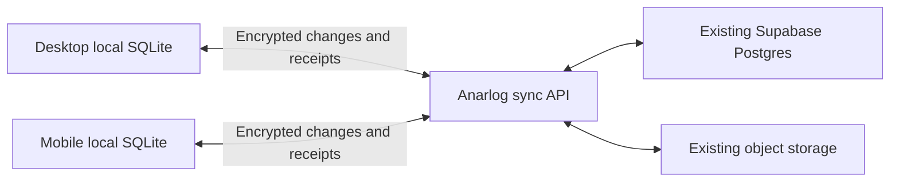

# SQLite Cloud to Supabase migration runbook

## Status and use

- **Revision:** 2, November 15, 2026, Asia/Seoul.
- **Status:** Execution started November 15 at John's direction. P0 inventory is partly refreshed. P1 server, deployment, desktop, verification, and audit changes are in draft [PR #8194](https://github.com/fastrepl/anarlog/pull/8194); nothing is merged or deployed and no production setting has changed. See the execution ledger.
- **Owner:** John Jeong. The engineer executing the migration maintains this file.
- **Tracking:** [ANLG-554](https://linear.app/fastrepl-inc/issue/ANLG-554/retire-sqlite-cloud-using-supabase-encrypted-replica-sync).
- **Canonical plan:** This file. Update it in place as decisions or evidence change; do not create competing plans in subsequent chats.
- **Current authorization:** On November 15 John directed the work to continue until the migration is complete. Pushing and the draft PR proceeded on that basis. Each gate below still needs its evidence before the step it guards: that direction does not waive a gate, and irreversible steps (provider resource deletion, cancellation) are taken only after their gate is recorded as passed.

Before continuing in another session, read this file, the execution ledger, the linked issues, and the current component instructions. Confirm the actual checkout, deployed versions, and environment. A checked box requires evidence tied to a version, environment, and time. Code existence, merged PRs, and earlier observations do not establish current production readiness.

Reviewing this plan settles the approach and defaults below. Production measurements and provider capabilities remain explicit preflight gates; do not invent their results to declare the plan executable.

## 1. Outcome and boundaries

Move Anarlog's hosted synchronization to its existing encrypted replica API backed by Supabase Postgres. Keep local SQLite, durable offline writes, E2EE keys, and the existing accepted-state/conflict protocol. Retire Anarlog's SQLite Cloud hosting dependency and verify that the CloudSync Enterprise charge ends.

Local reading, editing, and recording must continue through rollout and a temporary sync outage. Cross-device sync continuity is a qualification target, not a consequence of local-first storage. Unsupported old clients may need an update before cloud sync resumes; their local data must remain recoverable.

Included: personal/shared workspaces, enrollment and recovery, sharing/web editing/live collaboration, attachment references, deletion and revocation, deployment checks, operational costs, and provider retirement. Inventory CLI, local/hosted MCP, and other native consumers for shared-runtime impact.

Excluded from this migration: a new sync vendor, plaintext cloud storage of private notes, changed document conflict policy, a new collaboration engine, another database host/region, relocating existing object storage, and Char's separately billed resources. Keep the current Supabase project initially. A capacity blocker stops rollout rather than silently creating a second project.

Retain the local CloudSync extension for the first migration. Existing SQLite triggers and schema initialization can require it even with replica networking. Removing it is a separate local-schema migration, with old-database upgrade and downgrade tests. Verify that retaining the local extension is compatible with the subscription/license exit before scheduling cancellation.

## 2. Evidence and remaining facts

### Observed baseline

These observations came from the November 14 investigation and November 15 source review. Refresh them before execution.

| Observation                                                                                                            | Meaning and limit                                                                                                                                      |
| ---------------------------------------------------------------------------------------------------------------------- | ------------------------------------------------------------------------------------------------------------------------------------------------------ |
| Receipt: $4,473 for November 14–December 14; $4,300 CloudSync Enterprise, $158 for two Pro projects, $15 extra storage | $4,300/month is the primary gross savings target. The receipt does not establish cancellation terms, renewal notice, or the incremental Supabase bill. |
| Production Supabase project `ijoptyyjrfqwaqhyxkxj`, Anarlog, `us-west-1`                                               | Verified through the existing authenticated CLI. The connector returned no projects; that was not proof that the project was absent.                   |
| 2,707 workspaces with encrypted sync initialized; 1,747 with cloud authority activated                                 | Neither count establishes replica-only transport or complete recoverability.                                                                           |
| About 97.75 GB database size; 87.00 GB encrypted event relation; 6.00 GB receipt relation                              | Physical relation sizes include indexes/TOAST. They are not logical note size or provisioned/billed disk.                                              |
| Estimated 27.6 million event rows and 9.5 million receipt rows                                                         | Catalog estimates, not exact reconciliation counts. Do not run an unbounded production scan to refresh them.                                           |
| 2,788 registered devices, 1,899 seen in the preceding 30 days; no per-account transport overrides                      | Device presence does not identify deployed versions or selected transport.                                                                             |
| A new protocol-2 encrypted event was observed                                                                          | The accepted-state path is active, but not qualified here for a complete provider exit.                                                                |
| Main inspected at `0a97fcd408aa62230484787e462be4b56bd4f1ee`                                                           | The local GitButler workspace also contains unrelated applied branches. Preserve their ownership.                                                      |

The source supports per-account transport selection and replica credentials on desktop; mobile requests replica credentials directly. The default desktop transport in source is still `sqlite_sync`. Canonical configuration inspection returned `e2ee_enforced`; the deployed transport default was not conclusively established.

### Refreshed November 15 (read-only)

| Observation                                                                                                                                                                                                                                             | Meaning and limit                                                                                                                                                                                                               |
| ------------------------------------------------------------------------------------------------------------------------------------------------------------------------------------------------------------------------------------------------------- | ------------------------------------------------------------------------------------------------------------------------------------------------------------------------------------------------------------------------------- |
| `supabase migration list --linked` on `ijoptyyjrfqwaqhyxkxj`: every local migration through `20261021045443` is applied and none is pending                                                                                                              | Hosted schema matches `main`. P1 so far adds no hosted migration.                                                                                                                                                               |
| Last successful `api_cd` runs by service: sync `7a58e6ba9c` (October 28, run 40664354707), core and billing `acdf190bde` (October 25), ai `2afba01e93` from a branch (October 19), gateway `36715ccb21` (October 5). Health reports 0.0.101 and 0.0.100 | Sync and core contain #7997, #8050, and #8061. The gateway image predates #8050/#8061 but forwards sync traffic (next row). Only gateway deploys tag, so no tag names the sync image.                                                 |
| No commit on `main` after `7a58e6ba9c` touches `crates/api-sync`, `crates/api-subscription`, `apps/api`, or `supabase/migrations` (checked at `0a97fcd408`)                                                                                           | Deployed sync code equals `main` for these paths until P1 merges.                                                                                                                                                               |
| Infisical prod `/anarlog/cloudsync`: protocol mode `e2ee_enforced`, token TTL 3600 seconds, desktop transport unset, lifecycle mode unset                                                                                                               | Effective transport default is `sqlite_sync` if Fly matches Infisical. Fly machine images and staged secrets were not inspected because the local Fly session had expired.                                                      |
| `replica` capability header first shipped in desktop 1.4.24 (#7503); accepted-state outbox and update-required handling in 1.4.29 (#7997); contention fixes in 1.4.30. Latest stable tag is 1.4.34                                                      | Builds 1.4.24 through 1.4.28 advertise `replica` without the outbox or any handling of a fenced workspace. Existing identifiers cannot separate them from later builds, so capability negotiation was extended (section 4).     |
| Desktop sends no app version on credential requests; mobile calls `/sync/replica/credentials` with no capability header                                                                                                                                 | Mobile is unaffected by the lifecycle gate. Its accepted-state coverage per build still needs P2 qualification.                                                                                                                 |
| `POST https://api.anarlog.so/sync/token` answers 401 with `via: 1.1 fly.io, 2 fly.io, 2 fly.io`; the same request to `anarlog-sync.fly.dev` and `/health` on the gateway carry only `2 fly.io, 2 fly.io`. `fly.gateway.toml` sets `ANARLOG_SYNC_ORIGIN`    | The gateway forwards sync requests one more proxy hop, consistent with the checked-in profile. Header evidence only; machine configuration was not read because both the Fly CLI and dashboard sessions are signed out.         |

### Relevant history

- [ANLG-219](https://linear.app/fastrepl-inc/issue/ANLG-219/make-cloudsync-backend-portable-for-self-hosted-deployments): completed portability work, [PR #6798](https://github.com/fastrepl/anarlog/pull/6798). Keep it closed; this migration is new scope.
- [ANLG-453](https://linear.app/fastrepl-inc/issue/ANLG-453/make-accepted-cloud-state-authoritative-while-preserving-offline-edits): accepted cloud ordering, durable outbox, idempotent receipts, and legacy fencing. [PR #7997](https://github.com/fastrepl/anarlog/pull/7997) merged October 5. Deployment/client coverage still needs verification.
- ANLG-453 records retirement of the old plaintext database on October 12. The encrypted SQLite Cloud database remained. Do not confuse plaintext retirement, workspace authority activation, and provider retirement.
- [ANLG-469](https://linear.app/fastrepl-inc/issue/ANLG-469/stop-e2ee-acceptance-contention-from-starving-production-database): sync acceptance contention exhausted PostgREST capacity and affected billing. It also records auth retry amplification. Verify the serving fixes and reproduce resistance to both failure modes before adding load.

### Source map

| Area                                   | Starting points                                                                                                                                                                                                                                                  |
| -------------------------------------- | ---------------------------------------------------------------------------------------------------------------------------------------------------------------------------------------------------------------------------------------------------------------- |
| Credential selection and configuration | [config](../../crates/api-sync/src/config.rs), [transport overrides](../../crates/api-sync/src/routes/cloudsync_credentials/transport.rs), [desktop exchange](../../apps/desktop/src/auth/cloudsync-token-exchange.ts)                                           |
| Router/provider coupling               | [sync router](../../apps/api/src/routes/sync.rs), [API state](../../crates/api-sync/src/state.rs)                                                                                                                                                                |
| Accepted publication and recovery      | [native witness](../../crates/db-sync/src/witness.rs), [accepted client](../../crates/db-sync/src/witness/accepted.rs), [authority/outbox](../../crates/db-app/src/e2ee/authority.rs), [accepted API](../../crates/api-sync/src/routes/e2ee_witness/accepted.rs) |
| Local extension dependency             | [desktop database opening](../../plugins/db/src/runtime/open.rs), [shared schema](../../crates/db-app/src/lib.rs), [mobile bridge](../../crates/mobile-bridge/src/lib.rs)                                                                                        |
| Deletion                               | [cleanup worker](../../crates/api-subscription/src/cleanup_worker.rs), [provider cleanup](../../crates/api-subscription/src/cloudsync_cleanup.rs), hosted account-deletion migrations/tests                                                                      |
| Deployment coupling                    | [service secret selection](../../.github/scripts/prepare_api_service_secrets.py), [provider verifier](../../.github/scripts/verify_cloudsync_e2ee.py), [API deployment](../../.github/workflows/api_cd.yaml)                                                     |

## 3. Non-negotiable data rules

1. Keep plaintext and recovery keys on authorized devices. Auditors compare opaque identifiers, ciphertext, and hashes; production exports stay encrypted and access-controlled.
2. Preserve workspace isolation, membership checks, device enrollment, key rotation/revocation, and existing entitlement checks on every route.
3. Preserve accepted ordering, workspace compare-and-swap, immutable mutation identity, receipt replay checks, and the legacy authority boundary. A witness proving existence is not proof that a version is current.
4. Persist pending local mutations and their merge base before hydration can replace local state. A lost response or restored backup must not republish an already accepted old edit over newer cloud state.
5. Apply coherent document/chunk batches atomically. Interrupted pulls must not expose partial notes or transcripts. Preserve deletion tombstones and conflict copies.
6. Never reset accepted heads, remove an authority fence, truncate the event log, or clear pending edits to make migration or rollback appear successful.
7. Do not require every dormant device to reconnect. Require complete cloud recovery plus a tested upgrade path that preserves its unsent local edits when it eventually returns.
8. Treat device-local data as device-local. Do not upload previously unsynced/private tables merely because a provider is changing.

## 4. Implementation decisions

### Provider lifecycle and compatibility

One explicit server setting, implemented locally on `refactor/supabase-sync-migration` and not deployed: `ANARLOG_SQLITECLOUD_MODE=enabled|draining|retired`. Unset resolves to `enabled` when any provider variable is present, which covers existing deployments, and to `retired` when none is, which preserves today's replica-only behavior for self-hosted and local APIs. The cleanup owner does not accept that inference and needs an explicit `retired`. `/health/sync` reports the resolved mode. Keep `ANARLOG_CLOUDSYNC_DESKTOP_TRANSPORT` as the transport preference during overlap; it is not a provider retirement switch.

| Mode       | Credentials                                                                                                                          | Provider access and cleanup                                                                                                    |
| ---------- | ------------------------------------------------------------------------------------------------------------------------------------ | ------------------------------------------------------------------------------------------------------------------------------ |
| `enabled`  | Existing behavior; capable accounts can receive replica credentials through overrides/default                                        | Existing SQLite Cloud credentials and cleanup remain valid.                                                                    |
| `draining` | Replica credentials for qualified clients; HTTP 426 `cloudsync_upgrade_required` for unsupported clients; no new SQLite Cloud tokens | Retain administrative access for fencing, audit, and deletion. Previously issued tokens require explicit handling.             |
| `retired`  | Replica only; legacy credentials remain disabled                                                                                     | Require no SQLite Cloud secret and make no runtime request to that provider. Enter only after retirement evidence is complete. |

Lifecycle mode takes precedence over stale per-account overrides. In `draining`/`retired`, an old `sqlite_sync` override cannot re-enable issuance. Validate unknown modes and incomplete provider config at startup; do not silently fall back. Retired-mode deploys must not accidentally require historical provider IDs or verification keys.

Keep existing URL paths and successful credential/payload shapes. Make `/sync/token` a stable compatibility endpoint with the same auth, entitlement, device, and key checks as `/sync/replica/credentials`. Do not make supported clients depend on a 404 fallback. Preserve accepted-event APIs and limits. Regenerate OpenAPI/client output only where the actual contract changes.

Inventory exact packaged client versions/builds. A `replica` capability header alone does not prove safe outbox/authority support. Establish the minimum supported version per release channel from executable tests; extend capability negotiation only if existing identifiers cannot distinguish qualified builds. Add explicit update-required UI and stop retry storms on 426. Reuse current updating/sign-in mechanisms; do not force logout, clear storage, or block local editing.

**Decision recorded November 15, open to review before Gate P2:** existing identifiers cannot distinguish qualified builds (section 2), so desktop now also advertises `accepted_replica`, and in `draining`/`retired` `/sync/token` issues replica credentials only to clients that send it. The first release carrying this change becomes the minimum desktop build for draining; stable 1.4.29 through 1.4.34 would have to update even though they have the outbox, because nothing they send separates them from 1.4.24 through 1.4.28. Accepting plain `replica` instead would admit those five builds. `enabled` mode is unchanged, and `/sync/replica/credentials` stays ungated because its callers already chose the replica and the workspace authority fence governs them.

Transport and authority are separate transitions. Audit both. For a legacy workspace, the first accepted write can fence old witness clients. Do not activate it without a tested old-client upgrade path and a known complete baseline. Where eligibility cannot be gated reliably, add the smallest workspace-scoped server gate before exposing the transition.

### Remove cloud-provider coupling

- Build sync application state from Supabase/storage configuration, with optional provider-specific credentials. Avoid introducing a generic database-provider framework.
- Mount sharing, shared attachments, web editing, and live collaboration independently of SQLite Cloud availability. Preserve their current authentication and authorization.
- Keep provider deletion active through `draining`. In `retired`, complete deletion through Supabase/storage and the existing deletion ledger; never mark a legacy provider purge successful merely because its client is missing. Drain or explicitly reconcile outstanding deletion jobs before retiring the provider, and prevent archives from restoring erased accounts.
- Change deployment secret selection, verification, readiness, and rollback images to support the three modes. Replace provider-specific verification with equivalent encrypted replica, isolation, recovery, and deletion checks after retirement; do not simply delete the checks. Implemented as a live check run by deploy verification with two dedicated Pro accounts named by `ANARLOG_REPLICA_VERIFY_*` in `/anarlog/cloudsync` (see `apps/api/AGENTS.md`): optional while the provider exists, required in `retired`. Deletion is covered by the hosted database test and the staging run, not by the per-deploy check, because the verification accounts are long-lived.
- Audit sync/core/billing service ownership before deployment. Today the workflow exposes separate service targets; touching subscription code does not by itself establish which running process owns cleanup.

### Local storage and keys

Switch networking using the existing runtime. Preserve the database file, schema, keychain entries, account bindings, and active recording lifecycle. Retain the native extension and shipped SQLite migrations. Any unavoidable new local migration must be additive, shared by desktop/mobile, and follow the repository's compatibility policy.

The migration must work for fresh installs, upgraded installations with old CloudSync triggers, and restored local backups. Private attachment/audio storage remains in its current service; verify references, hashes, and permissions rather than copying blobs into Postgres.

## 5. Data audit and reconciliation

Build one resumable audit command using existing client/Rust protocol code where possible. Its default is read-only. Repairs require an explicit execution mode and a recorded allowlist of affected workspaces; never make a scan implicitly write.

Implemented as `.github/scripts/audit_cloudsync_replica.py`. It walks the provider one workspace at a time and classifies every provider record against the Supabase log by record id and ciphertext hash: `current` (equals the newest log value), `covered_historical` (equals an older log value), `diverged` (the record is in the log but this value never was), or `missing`. `diverged`, `missing`, and provider workspaces whose id is not a UUID fail the run with exit code 2. It has no repair mode, following comparison rule 4: `--archive` saves unresolved ciphertext for an authorized client instead. `--source` names the provider state compared, and one evidence directory holds one source. It has run only against test doubles and, for the Supabase queries, the local stack; its first provider run is P2 work.

### Inventory and evidence

- Capture source/provider resource IDs, deployed SHAs/images, database migration versions, client versions/capabilities, effective settings, token TTLs, writer identities, and backup/restore status. Store references, never credentials, in the ledger.
- Produce per-workspace manifests of opaque record IDs and ciphertext hashes, plus source snapshot identity and Supabase sequence boundary. Preserve complete encrypted payloads needed for recovery separately from hash-only audit manifests.
- Use keyset pagination, bounded batches/concurrency, statement/request timeouts, and persisted progress. Start with one audit worker. Throttle or stop on the same database-health signals as rollout. Avoid long production transactions and full-table count/hash scans.
- Store reports/exports in a private encrypted evidence location outside Git. Link access-controlled evidence from the ledger. Never put customer payloads, emails, workspace memberships, or keys in commits or general telemetry.

### Comparison rules

1. Compare against immutable, identified source snapshots or validated transaction snapshots. A moving multi-page export is preliminary evidence only. Record a stable Supabase `throughSequence` for each comparison.
2. A matching `(workspace, record, payload hash)` proves ciphertext coverage, not current-version correctness. Reconstruct state with the same legacy/accepted boundary semantics as clients and validate hashes without decrypting on the server. When interpreting encrypted revisions or document semantics requires keys, use an authorized client; hashes or export row order alone cannot establish that a missing version is superseded.
3. Classify each mismatch as covered historical data, a provably superseded value, missing recoverable ciphertext, or unresolved divergence. Every source record must have a disposition. Verify tombstones and chunk/manifests through an authorized client recovery test.
4. Never append an old SQLite Cloud value as a newly accepted edit merely because it is missing from the log. Keep divergent ciphertext in a recovery archive; an authorized client must decrypt, reconcile with the accepted baseline, preserve conflict copies, and publish through existing conditional acceptance. Mutation IDs remain immutable client-generated identities; accepted sequence numbers and receipts are server-issued.
5. For cloud-only data with no available trusted device, retain the encrypted source and verify a supported recovery-client path before retirement. If recovery cannot be demonstrated, the retirement gate fails; do not infer completeness from other devices.
6. Re-run a final comparison after SQLite Cloud writes are fenced. Include late writes, deletion jobs, and changes during earlier scans. Supabase writes may continue; compare against explicit boundaries and account for later events.

A deployment cannot promise zero user interruption if the provider lacks a reliable online snapshot or write fence. Qualify those mechanisms in preflight. If a brief legacy sync pause is necessary, keep local writes available, display pending sync honestly, and record its duration. Do not drop or overwrite pending data to avoid showing a pause.

## 6. Phases and gates

### P0 — Finalize and measure

- [ ] Review the plan defaults, ownership, scope, and execution authorization.
- [ ] Refresh the inventory and verify the actual deployed fixes associated with ANLG-453 and ANLG-469.
- [ ] Validate snapshot/export, fencing/revocation, cancellation notice, local-extension licensing, and backup restoration.
- [ ] Record 72 hours of baseline sync, auth, database, billing/account-read, egress, and storage-growth measurements; existing retained metrics may supply this window.
- [ ] Create the cost forecast and select the exact minimum supported client builds based on tests, not guessed version numbers.

**Gate P0:** the prerequisites have an evidence-backed answer. A provider limitation or unknown production behavior remains a blocker, not an implementation assumption.

### P1 — Implement provider-independent operation

- [ ] Implement lifecycle/configuration, compatible credentials, route separation, deletion handling, and provider-independent deployment verification.
- [ ] Preserve and qualify local state, enrollment, auth recovery, and the offline-upgrade path.
- [ ] Implement audit/reconciliation tooling and missing telemetry without logging content.
- [ ] Implement necessary fixes for bounded retries/admission or pool isolation exposed by qualification; preserve authoritative CAS and idempotency.
- [ ] Commit coherent changes on the existing relevant GitButler branch or `refactor/supabase-sync-migration`; do not mix other agents' work. Push/PR only when authorized.

**Gate P1:** isolated staging passes with SQLite Cloud credentials absent and provider network access blocked, including sharing and deletion. No production switch is needed to demonstrate this gate.

### P2 — Qualify recovery and capacity

- [ ] Complete the scenario matrix and all affected CI/native checks on the exact candidate.
- [ ] Restore from a cloud backup plus local pending edits in an isolated environment. Record recovery time and prove no accepted-data loss; do not roll a production sequence backwards during this exercise.
- [ ] Exercise synthetic load at twice the measured peak accepted-write and reconnect rate for one hour, including a deliberately contended workspace and multiple API instances.
- [ ] Run account/entitlement reads and checkout preparation during the load test without creating payments. Include token-refresh failures and 429/Retry-After recovery.
- [ ] Complete baseline data coverage and fresh-device recovery for pilot accounts, including a large history and shared workspace.
- [ ] Verify both the candidate and its designated rollback image can run in replica-only mode with the current schema.

**Gate P2:** no data-integrity failures or cross-tenant access; no pool-acquisition failures in the concurrent non-sync probes; bounded retry behavior; documented capacity and cost headroom. An unavailable platform or skipped native job remains unqualified.

### P3 — Roll out compatible accounts

First deploy the qualified additive hosted migrations, then compatible API changes in `enabled` mode with the existing transport default, then publish/distribute the qualified client builds through their own release channels. Verify the deployed artifacts before selecting the pilot. Publishing clients does not itself authorize activating legacy workspaces; keep the eligibility gate in place until their baseline is ready.

Keep SQLite Cloud enabled for unconverted accounts while routing qualified accounts to replica using `sync_transport_overrides`. Enroll complete shared-workspace groups; include every member account connected to those workspaces or defer that group. Since selection is per account, inventory all workspaces reachable by each selected account.

Before activating cloud authority in a cohort, prove that legacy reads/writes are fenced and that a client holding an unexpired provider token cannot falsely acknowledge a write outside the accepted ledger. An account override alone does not provide this guarantee: old builds without the replica header can still request SQLite Cloud credentials. If the existing protocol cannot enforce the boundary, add scoped issuance/access fencing and wait for outstanding access to expire before activating that workspace. Preserve any resulting late ciphertext for reconciliation.

| Stage                          | Minimum observation | Gate                                                                                          |
| ------------------------------ | ------------------- | --------------------------------------------------------------------------------------------- |
| Internal/pilot accounts        | 48 hours            | Actual desktop/mobile, fresh recovery, offline return, sharing, and recording scenarios pass. |
| About 10% of eligible accounts | 48 hours            | Metrics meet section 8; no unresolved data differences.                                       |
| About 50% of eligible accounts | 48 hours            | Capacity, cost projection, and shared-workspace behavior remain acceptable.                   |
| 100% of eligible accounts      | 7 days              | Remaining legacy consumers are identified, with a supported upgrade/recovery disposition.     |

Use a deterministic account-group list and record the changes. Small traffic volumes require completing the scenario matrix rather than treating elapsed time as proof. Do not add test mutations to customer notes; use dedicated test workspaces.

**Gate P3:** supported clients use replica, shared groups converge, metrics remain within bounds, and the disposition of remaining old/offline clients is documented. Dormant clients do not need to be online, but their cloud data and upgrade path must be covered.

### P4 — Drain and retire SQLite Cloud

Perform these steps in order; record evidence after each one:

1. Verify the qualified provider-independent server/client changes are deployed from P3. Confirm exact artifacts, rollback compatibility, and production health, including billing/account reads. Requalify any intervening code/schema changes before draining.
2. Set replica as the default. Enter `draining`; unsupported clients receive update-required, while supported clients continue sync. Verify no path, machine, admin job, or alternate credential issuer creates provider tokens.
3. Fence provider writes and revoke credentials/connections where supported. Otherwise wait at least the maximum TTL actually issued plus five minutes, then prove expired sessions cannot keep writing. Source currently caps new tokens at one hour; do not assume historical or administrative credentials obey that cap. TTL elapsed alone is not fencing evidence.
4. Confirm a stable provider write boundary. Finish the final encrypted export and reconciliation, drain deletion work, and verify recovery from the export without the provider.
5. Remove the Anarlog encrypted database and its separately managed CloudSync registration after the data gate passes. Preserve deletion confirmations. Do not rely on deleting only one resource; prior retirement work found that registration survives physical database deletion.
6. Enter `retired`; remove Anarlog-only provider runtime secrets and obsolete checks. Verify all serving machines use a compatible image and no runtime provider calls occur. Keep the compatible rollback image available.
7. Cancel the specific Anarlog CloudSync Enterprise subscription and unnecessary Anarlog hosting/storage lines. Verify resource ownership first; do not cancel Char's project, a shared organization subscription, or unrelated services.
8. Verify the cancellation's effective date, remaining charges, and provider resource inventory. Continue seven days of post-retirement monitoring and verify the next invoice when issued.

**Gate P4:** no production dependency remains; no unexplained ciphertext gap or unresolved deletion job; cancellation is confirmed. Mark financial verification pending until billing evidence exists.

### P5 — Close and retain recovery capability

- [ ] Record actual incremental Supabase/API spend and removed provider charges.
- [ ] Retain the encrypted retirement export for 30 days by default, subject to existing shorter deletion obligations; apply access controls and an auditable expiry. Account deletion must also suppress/remove retained user data according to the existing backup policy.
- [ ] Restore through the existing deletion ledger so an archive cannot recreate erased accounts or revoked access. Do not restore an archive wholesale into production.
- [ ] Verify archive expiry and close outstanding recovery/deletion exceptions before final closure.
- [ ] Track local-extension removal and any event-log compaction separately. Neither is automatically authorized by completing the hosted provider exit.

## 7. Verification matrix and required checks

Prefer strengthening existing tests; add focused regressions only for actual gaps or changed behavior. Use synthetic fixtures for fault injection and isolated hosted-db tests. Production verification uses bounded reads and dedicated test accounts/workspaces.

| Scenario                                                        | Required observable result                                                                                                  |
| --------------------------------------------------------------- | --------------------------------------------------------------------------------------------------------------------------- |
| Offline edit before switch; crash before first upload           | Original content and pending mutation survive restart and are accepted/reconciled later.                                    |
| Lost acknowledgement, duplicate request, restored pre-ID backup | Exactly one effective accepted mutation; old content does not overwrite newer accepted state.                               |
| Concurrent document edit, delete/edit, clock skew               | Existing merge/conflict-copy semantics; no silent loss, resurrection, or clock-based authority reversal.                    |
| Interrupted multi-page pull or protocol transition mid-pull     | Partial document/chunk state never becomes visible; restart completes safely.                                               |
| Fresh device, large history, missing chunk                      | Complete recovery or an explicit recoverable incomplete state, never a false synced indicator.                              |
| Old client returning months later; upgrading an old DB          | Local data opens, unsent edits survive upgrade, sync resumes on the qualified client.                                       |
| Mixed desktop/mobile and shared workspace                       | Correct convergence, isolation, membership change, key rotation, and revocation.                                            |
| Recording/transcription active during switch                    | Capture/save stays available; intentionally deferred sync resumes without corrupting transcripts.                           |
| Token expiry, revocation, 429, 426, transient outage            | Bounded backoff and useful state; no auth storm, forced local data loss, or endless retry on update-required.               |
| Export/import, CLI/local MCP, hosted agent access               | Existing contracts and device-local boundaries continue to work.                                                            |
| Attachments, audio references, sharing, web edit, live sockets  | Existing objects remain accessible only to authorized users with the provider unavailable.                                  |
| Account deletion during overlap and after retirement            | Both relevant stores and retained recovery paths honor deletion; no job stalls forever or falsely reports a provider purge. |
| Contended sync under multi-instance load                        | CAS remains correct; receipts replay safely; unrelated account/billing reads do not starve.                                 |
| Server rollback with new accepted data                          | Pending edits and monotonic authority survive; no fallback to legacy ordering.                                              |

Use current workflows and manifests as the command source when implementation starts. Minimum affected coverage:

- `cargo test --locked -p db-sync -p db-app -p db-core -p db-migrate -p mobile-bridge`, plus the API/auth/subscription suites and deployment Python checks in [api_ci.yaml](../../.github/workflows/api_ci.yaml).
- Isolated local `supabase db start` and `supabase test db`, with migration/RLS/deletion checks from [db_ci.yaml](../../.github/workflows/db_ci.yaml). Never point schema tests at production.
- Desktop/mobile TypeScript checks and existing tests; shared UI build first where required. Run platform-native builds/tests and database-upgrade coverage from [desktop_ci.yaml](../../.github/workflows/desktop_ci.yaml) and [mobile_ci.yaml](../../.github/workflows/mobile_ci.yaml).
- CLI/agent-access checks for shared-runtime changes; web checks for sharing/routing changes; exact native feature/target/exclusion flags from their workflows. Regenerate bindings/contracts through their owners.
- Formatting, license-boundary checks, complete common `node --test` suite, and workflow security scanning required by the root instructions.
- If a stable client release is required, follow the release workflow, verify candidate SHA and artifacts, and distinguish release publication from live migration qualification. General hardware/provider QA is separate unless explicitly requested; the migration scenarios above are this task's qualification requirements.

## 8. Observability, advancement, and stop rules

Instrument structured counters/histograms using existing telemetry. Record transport, protocol/capability, app version/platform, API version, stage, status class, retry reason, and aggregate byte counts. Keep customer identifiers in restricted diagnostic evidence only; never emit plaintext, keys, tokens, or encrypted payload bodies.

Measure end-to-end acceptance/convergence, oldest eligible pending edit, incomplete chunks, recovery duration, 409/429/5xx and 426 counts, auth refresh attempts, provider issuance/traffic, Postgres CPU/disk/I/O, connection-pool wait, lock waits, and account/billing probe latency. Separate expected recording deferral and genuinely offline devices from stalled online clients. Do not subtract intentional pauses from the underlying data-age measurement; display both.

The following are proposed operational defaults. Review them with this plan; change them only with a recorded reason before starting a cohort, not retroactively to turn a failed gate green.

| Signal                               | Advance condition / stop rule                                                                                                                                                                                                                                                                   |
| ------------------------------------ | ----------------------------------------------------------------------------------------------------------------------------------------------------------------------------------------------------------------------------------------------------------------------------------------------- |
| Integrity, isolation, recoverability | Any confirmed loss, unauthorized access, receipt inconsistency, authority regression, or missing required chunk stops expansion immediately.                                                                                                                                                    |
| Online ordinary-edit convergence     | p95 within 30 seconds outside intentional recording/offline deferral; no unexplained eligible pending mutation older than 10 minutes. Measure cold bootstrap separately.                                                                                                                        |
| Sync availability                    | Retry-exhausted operation failure rate below 1%, with no increase above baseline of more than 0.5 percentage points. Assess a rolling 15-minute window with at least 100 operations; use scenario qualification at lower volume. Expected 426s are tracked separately, not hidden as successes. |
| Account/billing availability         | Any new pool-acquisition failure stops expansion. p95 probe latency must not exceed the preflight baseline by more than 20% for two consecutive 15-minute windows.                                                                                                                              |
| Resource headroom                    | No growing lock/retry queue; no sustained CPU above 80% for 15 minutes; at least 30% usable provisioned disk headroom and 30 days of projected capacity at measured growth. Provisioned size and quotas must be measured, not inferred from relation bytes.                                     |
| Recovery/bootstrap                   | All scenario recoveries complete and p95 duration is no worse than the recorded size-matched baseline by more than 20%. An unmeasured baseline prevents claiming a performance pass.                                                                                                            |
| Cost                                 | Forecast net savings using measured compute, API traffic, database/object-storage egress, disk/index/WAL growth, backups, and logs. Do not expand into a forecast that costs at least as much as the removed service. Record recurring and one-time costs separately.                           |

Alerts go through existing operational channels. Draft any customer-facing upgrade or transition notice for review before sending; drafting this plan does not authorize outreach.

The roughly 87 GB append-only event relation makes growth and bootstrap cost material. Do not truncate events, expire receipts, or invent snapshots during cutover. If the load/cost gate requires compaction, pause rollout and specify a separately reviewed snapshot/cursor/receipt-retention protocol preserving old-device recovery.

## 9. Incident response and rollback

1. Stop adding accounts and record the failing stage, images, configuration, timestamps, and restricted evidence. Preserve current logs, cursors, pending data, and accepted events.
2. Keep local editing/recording available. Rate-limit or temporarily pause sync publication when needed to protect the shared database, with durable client retries and accurate pending state.
3. Roll back API/client behavior only to the designated image/build tested against the same schema and accepted-state protocol. Keep additive hosted migrations in place. Test forward recovery before restoring traffic.
4. After accepted writes, Supabase remains authoritative. Do not set an override back to SQLite Cloud as a generic rollback, remove the fence, or replay stale provider rows. A reverse migration would require its own reconciled design and is out of scope.
5. Database disaster recovery is separate from deployment rollback. Restore to an isolated target, reconcile accepted sequence/receipt state and deletion obligations, and verify clients reject regressed heads. Never present an older backup as current production state without a reviewed recovery procedure.

Changing a client's transport and activating cloud authority are different events. The first accepted write may be an irreversible protocol boundary for that workspace even while SQLite Cloud still exists. Preserve that distinction in the cohort ledger.

## 10. Commercial exit and schedule

The receipt's next service boundary is December 14, 2026. Verify actual renewal/cancellation terms and notice deadlines in P0; the receipt alone does not guarantee a cancellation window or refund. Resolve license terms for continued distribution/use of the local extension at the same time.

Gross annualized CloudSync Enterprise spend is $51,600 at the shown monthly rate. The final report uses actual removed charges minus incremental Supabase/API/storage/backup/log costs. It must not claim the entire $4,473 invoice is eliminated: two Pro projects include Char, and ownership must be checked before changing them. Recheck [Supabase pricing](https://supabase.com/pricing) against the organization's actual plan/discounts when modeling cost.

Planning estimate: 2–3 weeks if the existing replica path qualifies and no data-recovery, licensing, capacity, or client-distribution blocker appears. The minimum observation windows alone total 13 days; engineering, release propagation, and final reconciliation can extend the schedule. The billing date does not waive an integrity gate. Financial close and 30-day archive expiry may occur after the technical cutover.

## 11. Execution ledger

Update this table with concise evidence links and exact versions. Keep raw test logs, exports, and customer details in their appropriate protected systems. Linear tracks material decisions and blockers; this file remains the plan and checkpoint index.

| Gate                             | State           | Evidence required before marking complete                                                                              |
| -------------------------------- | --------------- | ---------------------------------------------------------------------------------------------------------------------- |
| Plan review                      | Execution directed | John asked to start the migration on November 15. The capability decision in section 4 and the section 8 thresholds still await his explicit review. |
| P0 inventory/commercial/baseline | In progress     | Resource inventory, mode/versions, snapshot/fence proof, license/cancellation terms, 72-hour baseline, cost model.     |
| P1 implementation                | In progress     | Scoped commits/PRs, contracts, audit tool, provider-independent staging checks. Draft PR #8194; server-only staging run recorded below. |
| P2 qualification                 | Not started     | Candidate SHAs/artifacts, scenario outcomes, restore/load results, minimum supported client list.                      |
| P3 pilot                         | Not started     | Account-group evidence, 48-hour metrics, reconciliation and recovery results.                                          |
| P3 10%                           | Not started     | Group list, 48-hour metrics, gate decision.                                                                            |
| P3 50%                           | Not started     | Group list, 48-hour metrics, capacity/cost check.                                                                      |
| P3 all eligible                  | Not started     | Seven-day results and every remaining legacy-client disposition.                                                       |
| P4 drain/fence/reconcile         | Not started     | Last issuance, credential/session fencing proof, stable snapshots, zero unresolved data gaps, deletion reconciliation. |
| P4 retirement                    | Not started     | Resource/registration deletion, retired-mode serving images, zero provider traffic, cancellation confirmation.         |
| Post-retirement verification     | Not started     | Seven-day health/convergence/cost results.                                                                             |
| P5 financial/archive close       | Not started     | Next invoice, net spend comparison, archive expiry and deletion evidence.                                              |

For every rollout change record: operator, UTC timestamp, environment, exact cohort manifest reference, old/new settings, serving image/SHA, related database migration versions, metric window, result, and rollback image. Do not mark an entire phase complete because one command succeeded.

### Progress as of November 15

**P0, done read-only:** the refreshed observations in section 2, including the gateway forwarding check.

**P0, still open:**

- Fly machine images, digests, and staged secret names for sync, core, and gateway. The Fly CLI and dashboard sessions are both signed out; needs John to sign in.
- Snapshot/export and write-fence capabilities of SQLite Cloud, cancellation notice and renewal terms, and local-extension licensing.
- 72-hour baseline for sync, auth, database, billing/account reads, egress, and storage growth; provisioned disk and quota; the cost forecast.
- Supabase backup restoration into an isolated target.
- ANLG-469 resistance reproduced against the serving images, beyond confirming the fixes are deployed.

**P1, in draft PR #8194 on `refactor/supabase-sync-migration`:**

- Lifecycle mode, Supabase-only sync state, and always-mounted `/sync/token` with the three-mode behavior and the `accepted_replica` gate. Sharing, web editing, live documents, and attachment backups no longer depend on provider configuration.
- Account deletion by mode: provider purge while enabled or draining, Supabase cascade once retired, never a purge inferred from a missing client. The hosted test asserts the cascade removes the encrypted log and receipts.
- Deployment secret selection and provider verification for the three modes, with operator documentation in `apps/api/AGENTS.md`.
- Desktop: advertises `accepted_replica`, treats 426 as update-required without retrying, and shows that state in sync settings.
- Replica deploy verification (`crates/db-sync/tests/replica.rs`, run by `verify_cloudsync_e2ee.py`) and the coverage audit command (section 5).
- One structured `cloudsync_token_request` event per `/sync/token` decision with lifecycle mode, advertised capability, and outcome. Clients send no version, so the capability stands in for it; the remaining section 8 measurements come from existing request spans and database metrics and have no dashboard yet.

Checks at head `6cce1627eb`: CI on the first push passed (`api_ci`, `db_ci`, desktop JS and i18n, fmt, lint, zizmor; native desktop and mobile jobs do not run on PRs). Locally: `cargo test --locked -p api-sync -p api-subscription -p api -p db-sync`, the five deployment Python suites, `supabase test db` on an isolated stack (68 files, 1,511 tests), and desktop typecheck, lint, and tests.

**Gate P1 staging run, November 15, local:** debug build of the API at `097ca84db9` with `ANARLOG_SERVICE=all`, `ANARLOG_SQLITECLOUD_MODE=retired`, every provider variable empty, an isolated local Supabase stack, and all outbound HTTP(S) routed to a proxy that refuses every host.

- `/health/sync` reported `retired`. Deploy verification passed five consecutive runs: `/sync/token` answered 426 without `accepted_replica` and replica credentials with it, a fresh device joined existing accepted history with a pending edit, a second fresh device recovered it, and a second Pro account got 403 on the first account's workspace.
- Sharing: a share created through Supabase published a snapshot and minted a live ticket; the attachment-backup route answered 422 to an empty body rather than 404.
- Deletion: `DELETE /subscription/delete-account` returned 202. After the job's 24-hour sweep delay was advanced in the scratch database, the worker removed the auth user, its workspace, 168 encrypted events, and 7 receipts without any provider request.
- The proxy recorded four outbound attempts, all to `app.loops.so`. Nothing tried to reach SQLite Cloud.

Limits of that run: it is a local stack, not hosted staging; the client was the Rust sync library, not a packaged desktop or mobile build; web editing and live sockets were exercised only as far as ticket issuance; the Stripe client does not use the proxy, and the deleted account had no Stripe customer. Gate P1 is therefore met for the server in isolation and remains open for packaged clients.

**P1, still open:**

- Two dedicated Pro verification accounts in production and their eight `ANARLOG_REPLICA_VERIFY_*` values. Until they exist every deploy warns that the replica was not verified, and a `retired` deploy fails.
- Workspace-scoped gate for authority activation if qualification shows the existing fence is not enough, and any retry or pool isolation fixes qualification exposes.
- Packaged desktop and mobile clients against a provider-free stack.
- Mobile and CLI/MCP inventory for shared-runtime impact; no change was needed so far.

**Next action:** review and merge PR #8194, then close the open P0 items (Fly inventory, provider snapshot and fence capabilities, contract terms, 72-hour baseline) and provision the verification accounts before P2. Do not begin with a production transport flip.
